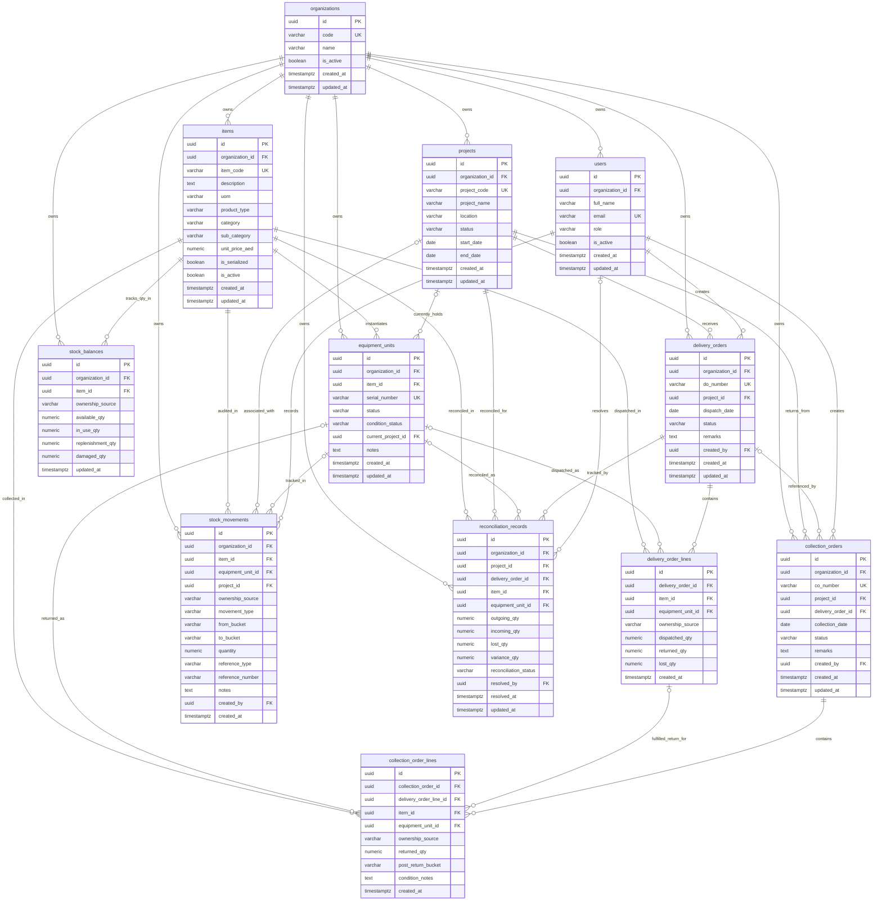
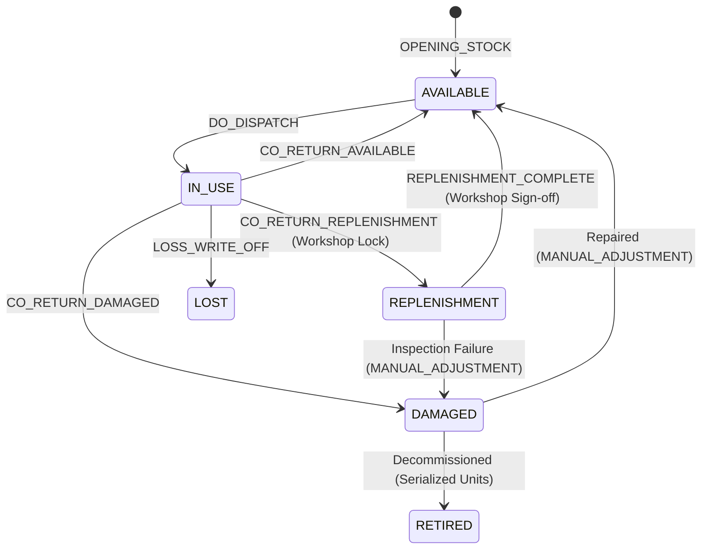

# SDD-1: Database Design Specification — SER Inventory Management System

> **Single Source of Truth** for the PostgreSQL relational schema, constraints, indexes, legacy Excel migration mappings, and transactional state-transition invariants.
> **Implementation Gate:** **LOCKED** — Approved as the canonical database blueprint for generating SQLAlchemy 2.0 ORM models and Alembic migrations inside `backend/database/`.

---

## 1. Document Metadata & Design Principles

### 1.1 Metadata

| Attribute | Value |
| --- | --- |
| **Document ID** | `SDD-1-DB` |
| **Version** | `1.0.0` |
| **Status** | `LOCKED` |
| **Target RDBMS** | PostgreSQL 15+ (verified locally on PostgreSQL 18) |
| **ORM & Migrations** | SQLAlchemy 2.0 + Alembic (`backend/database/`) |
| **Backend / Frontend Stack** | FastAPI (Python 3.11+) / Next.js App Router (TypeScript) |
| **Primary Keys** | `UUID` generated via `gen_random_uuid()` (`pgcrypto` extension) |
| **Timestamps** | `TIMESTAMPTZ` stored in UTC (`DEFAULT now()`) |
| **Constraint Naming** | Deterministic Alembic convention (`pk_`, `fk_`, `uq_`, `ck_`, `ix_`) matching `backend/database/base.py` |

### 1.2 Core Architectural & Database Design Principles

1. **SaaS Multi-Tenancy via `organization_id` Isolation**
   - Every tenant-owned entity carries a non-null `organization_id` foreign key referencing `organizations(id)`.
   - Natural business keys (`item_code`, `serial_number`, `project_code`, `do_number`, `co_number`, `email`) are unique **per organization** (`UNIQUE (organization_id, <business_key>)`), enabling multi-department or multi-company SaaS expansion and future PostgreSQL Row-Level Security (RLS) without schema rewrites.
2. **Strict Separation of Serialized Assets vs. Bulk Accessories**
   - `items` is the unified master catalog (`product_type IN ('ASSET', 'ACCESSORY')`).
   - **Serialized Assets (`product_type = 'ASSET'`, `is_serialized = TRUE`)**: Individual physical units (generators, dewatering pumps, fuel tanks, welding machines, filter units) are tracked 1-to-1 in `equipment_units` by unique `serial_number` (`Eqp Sl.No`) alongside aggregate rollups in `stock_balances`.
   - **Bulk Accessories/Materials (`product_type = 'ACCESSORY'`, `is_serialized = FALSE`)**: Non-serialized materials (HDPE pipes, valves, fittings, gaskets, clamps, hoses) are tracked quantitatively (`NUMERIC(14, 3)` + `uom`) in `stock_balances` segmented by `ownership_source` (`SER`, `SUPPLIER`, `DWT`).
3. **Real-Time Stock Buckets & Atomic Transitions**
   - Inventory quantities are partitioned into four operational buckets:
     - `AVAILABLE`: Yard stock ready for immediate dispatch.
     - `IN_USE`: Actively deployed on a project site via an issued Delivery Order (`DO`).
     - `REPLENISHMENT`: Returned equipment/material locked in workshop servicing, calibration, or maintenance — **strictly blocked from dispatch**.
     - `DAMAGED`: Non-operational stock awaiting repair assessment or disposal.
     - *(Serialized units additionally support `RETIRED` for end-of-life/decommissioned assets.)*
   - All bucket quantity columns enforce `CHECK (qty >= 0)` and are updated exclusively inside ACID transactions using `SELECT ... FOR UPDATE` row locking to eliminate race conditions and negative stock.
4. **Immutable Append-Only Audit Ledger (`stock_movements`)**
   - Every inventory transition (opening stock, dispatch, return, workshop sign-off, loss write-off, manual adjustment) appends an immutable row to `stock_movements` inside the **same database transaction** that mutates `stock_balances` and/or `equipment_units`.
   - `stock_movements` has no `updated_at` column; rows are never updated or deleted. Corrections are recorded as offsetting ledger entries.
5. **Deterministic Reconciliation & Stored Generated Variance**
   - `reconciliation_records` tracks site accountability per `(project_id, delivery_order_id, item_id, equipment_unit_id)` using a PostgreSQL stored generated column:
     ```sql
     variance_qty NUMERIC(14, 3) GENERATED ALWAYS AS (outgoing_qty - incoming_qty - lost_qty) STORED
     ```
   - Eliminates stale spreadsheet formulas and guarantees exact mathematical consistency between dispatched, returned, lost, and outstanding quantities.
6. **Pragmatic Enum Strategy (`VARCHAR` + Named `CHECK` Constraints)**
   - Domain enums are enforced via `VARCHAR` columns paired with explicit named `CHECK` constraints rather than rigid PostgreSQL `CREATE TYPE ... AS ENUM` types. This preserves strict database-level validation while allowing clean, zero-downtime Alembic schema evolutions.
7. **Future AI Integration Readiness**
   - Normalized `stock_movements`, `equipment_units`, `stock_balances`, and `reconciliation_records` provide clean, time-indexed analytical datasets for future read-only AI modules (utilization forecasting, anomaly detection, replenishment turnaround prediction) with zero write-path coupling.

---

## 2. Entity-Relationship (ER) Diagram & Relationship Matrix

### 2.1 Mermaid ER Diagram (All 12 Tables)



### 2.2 Relationship Summary Matrix

| Parent Table | Child Table | Cardinality | Foreign Key Column | `ON DELETE` Rule | Rationale |
| --- | --- | --- | --- | --- | --- |
| `organizations` | `users` | `1:N` | `users.organization_id` | `RESTRICT` | Prevents accidental tenant deletion while users exist. |
| `organizations` | `projects` | `1:N` | `projects.organization_id` | `RESTRICT` | Preserves operational project history. |
| `organizations` | `items` | `1:N` | `items.organization_id` | `RESTRICT` | Protects catalog integrity. |
| `organizations` | `equipment_units` | `1:N` | `equipment_units.organization_id` | `RESTRICT` | Protects serialized asset registry. |
| `organizations` | `stock_balances` | `1:N` | `stock_balances.organization_id` | `RESTRICT` | Preserves inventory valuation & quantities. |
| `organizations` | `delivery_orders` | `1:N` | `delivery_orders.organization_id` | `RESTRICT` | Preserves dispatch audit trail. |
| `organizations` | `collection_orders` | `1:N` | `collection_orders.organization_id` | `RESTRICT` | Preserves return audit trail. |
| `organizations` | `stock_movements` | `1:N` | `stock_movements.organization_id` | `RESTRICT` | Immutable ledger must never cascade-delete. |
| `organizations` | `reconciliation_records` | `1:N` | `reconciliation_records.organization_id` | `RESTRICT` | Preserves financial/site discrepancy records. |
| `items` | `equipment_units` | `1:N` | `equipment_units.item_id` | `RESTRICT` | Cannot delete a catalog item that owns physical units (soft-deactivate via `is_active = FALSE`). |
| `items` | `stock_balances` | `1:N` | `stock_balances.item_id` | `RESTRICT` | Cannot delete an item with balance rows. |
| `items` | `delivery_order_lines` | `1:N` | `delivery_order_lines.item_id` | `RESTRICT` | Preserves historical DO line items. |
| `items` | `collection_order_lines` | `1:N` | `collection_order_lines.item_id` | `RESTRICT` | Preserves historical CO line items. |
| `items` | `stock_movements` | `1:N` | `stock_movements.item_id` | `RESTRICT` | Preserves immutable ledger integrity. |
| `items` | `reconciliation_records` | `1:N` | `reconciliation_records.item_id` | `RESTRICT` | Preserves reconciliation accountability. |
| `projects` | `equipment_units` | `0..1:N` | `equipment_units.current_project_id` | `RESTRICT` | Cannot delete a project while equipment units are currently deployed on site. |
| `projects` | `delivery_orders` | `1:N` | `delivery_orders.project_id` | `RESTRICT` | Historical DOs remain tied to their project. |
| `projects` | `collection_orders` | `1:N` | `collection_orders.project_id` | `RESTRICT` | Historical COs remain tied to their project. |
| `projects` | `stock_movements` | `0..1:N` | `stock_movements.project_id` | `RESTRICT` | Yard-only movements (`OPENING_STOCK`, `REPLENISHMENT_COMPLETE`) have `NULL`; project movements stay immutable. |
| `projects` | `reconciliation_records` | `1:N` | `reconciliation_records.project_id` | `RESTRICT` | Site reconciliation cannot be orphaned. |
| `equipment_units` | `delivery_order_lines` | `0..1:N` | `delivery_order_lines.equipment_unit_id` | `RESTRICT` | `NULL` for bulk accessories; protected for serialized assets. |
| `equipment_units` | `collection_order_lines` | `0..1:N` | `collection_order_lines.equipment_unit_id` | `RESTRICT` | `NULL` for bulk accessories; protected for serialized assets. |
| `equipment_units` | `stock_movements` | `0..1:N` | `stock_movements.equipment_unit_id` | `RESTRICT` | `NULL` for bulk accessories; protected for serialized unit history. |
| `equipment_units` | `reconciliation_records` | `0..1:N` | `reconciliation_records.equipment_unit_id` | `RESTRICT` | `NULL` for bulk accessories; protected for serialized asset tracking. |
| `delivery_orders` | `delivery_order_lines` | `1:N` | `delivery_order_lines.delivery_order_id` | `CASCADE` | Child lines belong strictly to their DO header (application blocks deleting non-`DRAFT` DOs). |
| `delivery_orders` | `collection_orders` | `0..1:N` | `collection_orders.delivery_order_id` | `RESTRICT` | Optional link to source DO (supports both DO-linked and consolidated site returns). |
| `delivery_orders` | `reconciliation_records` | `1:N` | `reconciliation_records.delivery_order_id` | `RESTRICT` | Reconciliation lines remain auditable against issued DOs. |
| `delivery_order_lines` | `collection_order_lines` | `0..1:N` | `collection_order_lines.delivery_order_line_id` | `RESTRICT` | Optional exact line-to-line linkage for precise return tracking. |
| `collection_orders` | `collection_order_lines` | `1:N` | `collection_order_lines.collection_order_id` | `CASCADE` | Child lines belong strictly to their CO header (application blocks deleting non-`DRAFT` COs). |
| `users` | `delivery_orders` | `1:N` | `delivery_orders.created_by` | `RESTRICT` | Preserves operator accountability (deactivate users via `is_active = FALSE`). |
| `users` | `collection_orders` | `1:N` | `collection_orders.created_by` | `RESTRICT` | Preserves operator accountability. |
| `users` | `stock_movements` | `1:N` | `stock_movements.created_by` | `RESTRICT` | Preserves immutable audit actor trail. |
| `users` | `reconciliation_records` | `0..1:N` | `reconciliation_records.resolved_by` | `RESTRICT` | Nullable until a discrepancy is formally resolved. |

---

## 3. Complete Table & Column Specifications (All 12 Tables)

### 3.1 `organizations`
Tenant / department isolation root table enabling SaaS multi-tenancy (e.g., `SER-UAE` as the primary tenant).

| Column | Type | Constraints | Default | Description |
| --- | --- | --- | --- | --- |
| `id` | `UUID` | `PRIMARY KEY` | `gen_random_uuid()` | Unique organization identifier. |
| `code` | `VARCHAR(32)` | `NOT NULL`, `UNIQUE` | — | Short uppercase organization code (e.g., `SER`, `SER-UAE`). |
| `name` | `VARCHAR(150)` | `NOT NULL` | — | Full organization or department display name. |
| `is_active` | `BOOLEAN` | `NOT NULL` | `TRUE` | Soft-status flag; inactive tenants are blocked from API access. |
| `created_at` | `TIMESTAMPTZ` | `NOT NULL` | `now()` | Record creation timestamp (UTC). |
| `updated_at` | `TIMESTAMPTZ` | `NOT NULL` | `now()` | Last modification timestamp (UTC). |

---

### 3.2 `users`
Application users and Role-Based Access Control (RBAC) assignments scoped per organization.

| Column | Type | Constraints | Default | Description |
| --- | --- | --- | --- | --- |
| `id` | `UUID` | `PRIMARY KEY` | `gen_random_uuid()` | Unique user identifier. |
| `organization_id` | `UUID` | `NOT NULL`, `FK -> organizations(id) ON DELETE RESTRICT` | — | Tenant scope owning this user. |
| `full_name` | `VARCHAR(120)` | `NOT NULL` | — | User's full display name for audit trails and order signatures. |
| `email` | `VARCHAR(255)` | `NOT NULL`, `UNIQUE (organization_id, email)` | — | Login email address (normalized lowercase at application layer). |
| `role` | `VARCHAR(32)` | `NOT NULL`, `CHECK (role IN ('ADMIN', 'SER_OPERATOR', 'WORKSHOP_LEAD', 'PROJECT_VIEWER'))` | — | RBAC role governing operational permissions. |
| `is_active` | `BOOLEAN` | `NOT NULL` | `TRUE` | Soft-deactivation flag (users with audit history are never hard-deleted). |
| `created_at` | `TIMESTAMPTZ` | `NOT NULL` | `now()` | Record creation timestamp (UTC). |
| `updated_at` | `TIMESTAMPTZ` | `NOT NULL` | `now()` | Last modification timestamp (UTC). |

> **SDD-2 Auth Note:** Credential storage (`password_hash` or external SSO subject identifier) will be finalized in SDD-2 (`auth` module design) as an additive column on `users` or a dedicated `user_credentials` table without altering core inventory foreign keys.

---

### 3.3 `projects`
Active and historical construction & dewatering project sites receiving equipment and materials.

| Column | Type | Constraints | Default | Description |
| --- | --- | --- | --- | --- |
| `id` | `UUID` | `PRIMARY KEY` | `gen_random_uuid()` | Unique project identifier. |
| `organization_id` | `UUID` | `NOT NULL`, `FK -> organizations(id) ON DELETE RESTRICT` | — | Tenant scope owning this project. |
| `project_code` | `VARCHAR(64)` | `NOT NULL`, `UNIQUE (organization_id, project_code)` | — | Official SER/ERP project code (e.g., `PRJ-2026-014`). |
| `project_name` | `VARCHAR(200)` | `NOT NULL` | — | Human-readable project name. |
| `location` | `VARCHAR(255)` | `NULL` | `NULL` | Physical site location / emirate / area. |
| `status` | `VARCHAR(20)` | `NOT NULL`, `CHECK (status IN ('ACTIVE', 'COMPLETED', 'CLOSED'))` | `'ACTIVE'` | Lifecycle status (`CLOSED` projects cannot receive new DO dispatches). |
| `start_date` | `DATE` | `NULL` | `NULL` | Project mobilization / start date. |
| `end_date` | `DATE` | `NULL`, `CHECK (end_date IS NULL OR start_date IS NULL OR end_date >= start_date)` | `NULL` | Planned or actual completion date. |
| `created_at` | `TIMESTAMPTZ` | `NOT NULL` | `now()` | Record creation timestamp (UTC). |
| `updated_at` | `TIMESTAMPTZ` | `NOT NULL` | `now()` | Last modification timestamp (UTC). |

---

### 3.4 `items`
Master catalog defining both serialized equipment models (`ASSET`) and bulk accessories/consumables (`ACCESSORY`).

| Column | Type | Constraints | Default | Description |
| --- | --- | --- | --- | --- |
| `id` | `UUID` | `PRIMARY KEY` | `gen_random_uuid()` | Unique catalog item identifier. |
| `organization_id` | `UUID` | `NOT NULL`, `FK -> organizations(id) ON DELETE RESTRICT` | — | Tenant scope owning this item. |
| `item_code` | `VARCHAR(64)` | `NOT NULL`, `UNIQUE (organization_id, item_code)` | — | Unique SKU / SER Material List item code. |
| `description` | `TEXT` | `NOT NULL` | — | Standard technical description (e.g., `"6-inch Wellpoint Dewatering Pump"`, `"HDPE Pipe 160mm PN10"`). |
| `uom` | `VARCHAR(24)` | `NOT NULL` | `'NOS'` | Unit of measure (`NOS`, `MTR`, `SET`, `PCS`, `KG`, `LTR`, etc.). |
| `product_type` | `VARCHAR(20)` | `NOT NULL`, `CHECK (product_type IN ('ASSET', 'ACCESSORY'))` | — | Discriminator separating serialized machinery from bulk materials. |
| `category` | `VARCHAR(100)` | `NOT NULL` | — | Top-level classification (e.g., `Pumps`, `Generators`, `Piping & Fittings`). |
| `sub_category` | `VARCHAR(100)` | `NULL` | `NULL` | Granular sub-classification (e.g., `Wellpoint Pumps`, `HDPE Fittings`). |
| `unit_price_aed` | `NUMERIC(12, 2)` | `NOT NULL`, `CHECK (unit_price_aed >= 0)` | `0.00` | Standard replacement/valuation unit price in AED. |
| `is_serialized` | `BOOLEAN` | `NOT NULL`, `CHECK ((product_type = 'ASSET' AND is_serialized = TRUE) OR (product_type = 'ACCESSORY' AND is_serialized = FALSE))` | — | Explicit serialization flag tightly enforced with `product_type`. |
| `is_active` | `BOOLEAN` | `NOT NULL` | `TRUE` | Soft-deactivation flag for discontinued catalog items. |
| `created_at` | `TIMESTAMPTZ` | `NOT NULL` | `now()` | Record creation timestamp (UTC). |
| `updated_at` | `TIMESTAMPTZ` | `NOT NULL` | `now()` | Last modification timestamp (UTC). |

---

### 3.5 `equipment_units`
Individual physical instances of serialized `ASSET` items, identified by unique serial number (`Eqp Sl.No`).

| Column | Type | Constraints | Default | Description |
| --- | --- | --- | --- | --- |
| `id` | `UUID` | `PRIMARY KEY` | `gen_random_uuid()` | Unique physical unit identifier. |
| `organization_id` | `UUID` | `NOT NULL`, `FK -> organizations(id) ON DELETE RESTRICT` | — | Tenant scope owning this unit. |
| `item_id` | `UUID` | `NOT NULL`, `FK -> items(id) ON DELETE RESTRICT` | — | Catalog item reference (application enforces `items.is_serialized = TRUE`). |
| `serial_number` | `VARCHAR(100)` | `NOT NULL`, `UNIQUE (organization_id, serial_number)` | — | Unique manufacturer/SER equipment serial number (`Eqp Sl.No`). |
| `status` | `VARCHAR(20)` | `NOT NULL`, `CHECK (status IN ('AVAILABLE', 'IN_USE', 'REPLENISHMENT', 'DAMAGED', 'RETIRED'))` | `'AVAILABLE'` | Real-time operational bucket governing dispatch eligibility. |
| `condition_status` | `VARCHAR(20)` | `NOT NULL`, `CHECK (condition_status IN ('GOOD', 'NEEDS_SERVICE', 'DAMAGED'))` | `'GOOD'` | Physical workshop/inspection condition of the unit. |
| `current_project_id` | `UUID` | `NULL`, `FK -> projects(id) ON DELETE RESTRICT`, `CHECK ((status = 'IN_USE' AND current_project_id IS NOT NULL) OR (status <> 'IN_USE' AND current_project_id IS NULL))` | `NULL` | Active project holding this unit when `status = 'IN_USE'`; strictly `NULL` otherwise. |
| `notes` | `TEXT` | `NULL` | `NULL` | Maintenance remarks, inspection notes, or decommissioning details. |
| `created_at` | `TIMESTAMPTZ` | `NOT NULL` | `now()` | Record creation timestamp (UTC). |
| `updated_at` | `TIMESTAMPTZ` | `NOT NULL` | `now()` | Last modification timestamp (UTC). |

---

### 3.6 `stock_balances`
Real-time bucketed quantity ledger per `(organization_id, item_id, ownership_source)` — primary inventory source for `ACCESSORY` bulk stock and fast aggregate rollup for `ASSET` items.

| Column | Type | Constraints | Default | Description |
| --- | --- | --- | --- | --- |
| `id` | `UUID` | `PRIMARY KEY` | `gen_random_uuid()` | Unique stock balance row identifier. |
| `organization_id` | `UUID` | `NOT NULL`, `FK -> organizations(id) ON DELETE RESTRICT` | — | Tenant scope. |
| `item_id` | `UUID` | `NOT NULL`, `FK -> items(id) ON DELETE RESTRICT` | — | Catalog item reference. |
| `ownership_source` | `VARCHAR(20)` | `NOT NULL`, `CHECK (ownership_source IN ('SER', 'SUPPLIER', 'DWT'))` | `'SER'` | Ownership/sourcing pool (`SER` owned, `SUPPLIER` hired, `DWT` inter-division). |
| `available_qty` | `NUMERIC(14, 3)` | `NOT NULL`, `CHECK (available_qty >= 0)` | `0` | Quantity currently in yard and eligible for DO dispatch. |
| `in_use_qty` | `NUMERIC(14, 3)` | `NOT NULL`, `CHECK (in_use_qty >= 0)` | `0` | Quantity currently deployed at project sites. |
| `replenishment_qty` | `NUMERIC(14, 3)` | `NOT NULL`, `CHECK (replenishment_qty >= 0)` | `0` | Quantity locked in workshop servicing/repair (blocked from dispatch). |
| `damaged_qty` | `NUMERIC(14, 3)` | `NOT NULL`, `CHECK (damaged_qty >= 0)` | `0` | Quantity marked damaged/unserviceable (blocked from dispatch). |
| `updated_at` | `TIMESTAMPTZ` | `NOT NULL` | `now()` | Timestamp of the last atomic balance update (UTC). |

- **Composite Uniqueness:** `UNIQUE (organization_id, item_id, ownership_source)` (`uq_stock_balances_org_item_source`).

---

### 3.7 `delivery_orders`
Header table for outgoing Delivery Orders (`DO`) dispatching equipment and materials from the SER yard to a project site.

| Column | Type | Constraints | Default | Description |
| --- | --- | --- | --- | --- |
| `id` | `UUID` | `PRIMARY KEY` | `gen_random_uuid()` | Unique delivery order identifier. |
| `organization_id` | `UUID` | `NOT NULL`, `FK -> organizations(id) ON DELETE RESTRICT` | — | Tenant scope. |
| `do_number` | `VARCHAR(64)` | `NOT NULL`, `UNIQUE (organization_id, do_number)` | — | Official Delivery Order reference number (e.g., `DO-2026-00142`). |
| `project_id` | `UUID` | `NOT NULL`, `FK -> projects(id) ON DELETE RESTRICT` | — | Destination project site. |
| `dispatch_date` | `DATE` | `NOT NULL` | `CURRENT_DATE` | Date goods were dispatched from the yard. |
| `status` | `VARCHAR(24)` | `NOT NULL`, `CHECK (status IN ('DRAFT', 'DISPATCHED', 'PARTIALLY_RETURNED', 'CLOSED', 'CANCELLED'))` | `'DRAFT'` | Order lifecycle status (`DRAFT` does not deduct stock until transitioned to `DISPATCHED`). |
| `remarks` | `TEXT` | `NULL` | `NULL` | Gate pass notes, vehicle/driver details, or site delivery instructions. |
| `created_by` | `UUID` | `NOT NULL`, `FK -> users(id) ON DELETE RESTRICT` | — | Operator who created/issued the DO. |
| `created_at` | `TIMESTAMPTZ` | `NOT NULL` | `now()` | Record creation timestamp (UTC). |
| `updated_at` | `TIMESTAMPTZ` | `NOT NULL` | `now()` | Last modification timestamp (UTC). |

---

### 3.8 `delivery_order_lines`
Line-level items and serialized equipment units dispatched under a Delivery Order.

| Column | Type | Constraints | Default | Description |
| --- | --- | --- | --- | --- |
| `id` | `UUID` | `PRIMARY KEY` | `gen_random_uuid()` | Unique DO line identifier. |
| `delivery_order_id` | `UUID` | `NOT NULL`, `FK -> delivery_orders(id) ON DELETE CASCADE` | — | Parent Delivery Order header. |
| `item_id` | `UUID` | `NOT NULL`, `FK -> items(id) ON DELETE RESTRICT` | — | Dispatched catalog item. |
| `equipment_unit_id` | `UUID` | `NULL`, `FK -> equipment_units(id) ON DELETE RESTRICT` | `NULL` | Specific serialized unit (required for `ASSET`, `NULL` for `ACCESSORY`). |
| `ownership_source` | `VARCHAR(20)` | `NOT NULL`, `CHECK (ownership_source IN ('SER', 'SUPPLIER', 'DWT'))` | `'SER'` | Ownership pool deducted on dispatch. |
| `dispatched_qty` | `NUMERIC(14, 3)` | `NOT NULL`, `CHECK (dispatched_qty > 0)` | — | Quantity dispatched (`1` for serialized assets via `CHECK (equipment_unit_id IS NULL OR dispatched_qty = 1)`). |
| `returned_qty` | `NUMERIC(14, 3)` | `NOT NULL`, `CHECK (returned_qty >= 0)` | `0` | Cumulative quantity returned across linked Collection Orders. |
| `lost_qty` | `NUMERIC(14, 3)` | `NOT NULL`, `CHECK (lost_qty >= 0)` | `0` | Cumulative quantity formally written off as lost/unrecoverable. |
| `created_at` | `TIMESTAMPTZ` | `NOT NULL` | `now()` | Line creation timestamp (UTC). |

- **Table-Level Check:** `CHECK (returned_qty + lost_qty <= dispatched_qty)` (`ck_do_lines_return_loss_bound`).
- **Partial Unique Index:** `UNIQUE (delivery_order_id, equipment_unit_id) WHERE equipment_unit_id IS NOT NULL` prevents dispatching the same serialized unit twice on the same DO.

---

### 3.9 `collection_orders`
Header table for incoming Collection Orders (`CO`) returning equipment and materials from a project site back to the SER yard/workshop.

| Column | Type | Constraints | Default | Description |
| --- | --- | --- | --- | --- |
| `id` | `UUID` | `PRIMARY KEY` | `gen_random_uuid()` | Unique collection order identifier. |
| `organization_id` | `UUID` | `NOT NULL`, `FK -> organizations(id) ON DELETE RESTRICT` | — | Tenant scope. |
| `co_number` | `VARCHAR(64)` | `NOT NULL`, `UNIQUE (organization_id, co_number)` | — | Official Collection Order reference number (e.g., `CO-2026-00089`). |
| `project_id` | `UUID` | `NOT NULL`, `FK -> projects(id) ON DELETE RESTRICT` | — | Source project site returning items. |
| `delivery_order_id` | `UUID` | `NULL`, `FK -> delivery_orders(id) ON DELETE RESTRICT` | `NULL` | Optional reference to the originating DO (nullable for multi-DO consolidated site sweeps). |
| `collection_date` | `DATE` | `NOT NULL` | `CURRENT_DATE` | Date goods were collected and received at yard/workshop. |
| `status` | `VARCHAR(20)` | `NOT NULL`, `CHECK (status IN ('DRAFT', 'RECEIVED', 'CANCELLED'))` | `'DRAFT'` | Receipt lifecycle status (`RECEIVED` commits stock bucket updates). |
| `remarks` | `TEXT` | `NULL` | `NULL` | Return inspection notes, transport reference, or site sign-off remarks. |
| `created_by` | `UUID` | `NOT NULL`, `FK -> users(id) ON DELETE RESTRICT` | — | Operator who created/received the CO. |
| `created_at` | `TIMESTAMPTZ` | `NOT NULL` | `now()` | Record creation timestamp (UTC). |
| `updated_at` | `TIMESTAMPTZ` | `NOT NULL` | `now()` | Last modification timestamp (UTC). |

---

### 3.10 `collection_order_lines`
Line-level return receipts specifying the exact post-return operational bucket (`AVAILABLE`, `REPLENISHMENT`, or `DAMAGED`).

| Column | Type | Constraints | Default | Description |
| --- | --- | --- | --- | --- |
| `id` | `UUID` | `PRIMARY KEY` | `gen_random_uuid()` | Unique CO line identifier. |
| `collection_order_id` | `UUID` | `NOT NULL`, `FK -> collection_orders(id) ON DELETE CASCADE` | — | Parent Collection Order header. |
| `delivery_order_line_id` | `UUID` | `NULL`, `FK -> delivery_order_lines(id) ON DELETE RESTRICT` | `NULL` | Optional exact reference to the originating DO line for automated reconciliation. |
| `item_id` | `UUID` | `NOT NULL`, `FK -> items(id) ON DELETE RESTRICT` | — | Returned catalog item. |
| `equipment_unit_id` | `UUID` | `NULL`, `FK -> equipment_units(id) ON DELETE RESTRICT` | `NULL` | Specific serialized unit being returned (`NULL` for bulk accessories). |
| `ownership_source` | `VARCHAR(20)` | `NOT NULL`, `CHECK (ownership_source IN ('SER', 'SUPPLIER', 'DWT'))` | `'SER'` | Ownership pool credited upon receipt. |
| `returned_qty` | `NUMERIC(14, 3)` | `NOT NULL`, `CHECK (returned_qty > 0)` | — | Quantity received (`1` for serialized units via `CHECK (equipment_unit_id IS NULL OR returned_qty = 1)`). |
| `post_return_bucket` | `VARCHAR(20)` | `NOT NULL`, `CHECK (post_return_bucket IN ('AVAILABLE', 'REPLENISHMENT', 'DAMAGED'))` | — | Destination bucket assigned during yard/workshop intake inspection. |
| `condition_notes` | `TEXT` | `NULL` | `NULL` | Damage description, servicing requirements, or missing sub-parts noted on return. |
| `created_at` | `TIMESTAMPTZ` | `NOT NULL` | `now()` | Line creation timestamp (UTC). |

- **Partial Unique Index:** `UNIQUE (collection_order_id, equipment_unit_id) WHERE equipment_unit_id IS NOT NULL` prevents receiving the same serialized unit twice on the same CO.

---

### 3.11 `stock_movements`
Immutable append-only inventory audit ledger recording every stock bucket transition across the system.

| Column | Type | Constraints | Default | Description |
| --- | --- | --- | --- | --- |
| `id` | `UUID` | `PRIMARY KEY` | `gen_random_uuid()` | Unique ledger entry identifier. |
| `organization_id` | `UUID` | `NOT NULL`, `FK -> organizations(id) ON DELETE RESTRICT` | — | Tenant scope. |
| `item_id` | `UUID` | `NOT NULL`, `FK -> items(id) ON DELETE RESTRICT` | — | Catalog item affected. |
| `equipment_unit_id` | `UUID` | `NULL`, `FK -> equipment_units(id) ON DELETE RESTRICT` | `NULL` | Serialized unit affected (`NULL` for bulk accessories). |
| `project_id` | `UUID` | `NULL`, `FK -> projects(id) ON DELETE RESTRICT` | `NULL` | Associated project site (`NULL` for yard-only events such as `OPENING_STOCK` or `REPLENISHMENT_COMPLETE`). |
| `ownership_source` | `VARCHAR(20)` | `NOT NULL`, `CHECK (ownership_source IN ('SER', 'SUPPLIER', 'DWT'))` | `'SER'` | Ownership pool affected. |
| `movement_type` | `VARCHAR(32)` | `NOT NULL`, `CHECK (movement_type IN ('OPENING_STOCK', 'DO_DISPATCH', 'CO_RETURN_AVAILABLE', 'CO_RETURN_REPLENISHMENT', 'CO_RETURN_DAMAGED', 'REPLENISHMENT_COMPLETE', 'LOSS_WRITE_OFF', 'MANUAL_ADJUSTMENT'))` | — | Business event type driving the movement. |
| `from_bucket` | `VARCHAR(20)` | `NULL`, `CHECK (from_bucket IS NULL OR from_bucket IN ('AVAILABLE', 'IN_USE', 'REPLENISHMENT', 'DAMAGED', 'EXTERNAL'))` | `NULL` | Source bucket (`NULL` / `'EXTERNAL'` for initial opening stock). |
| `to_bucket` | `VARCHAR(20)` | `NULL`, `CHECK (to_bucket IS NULL OR to_bucket IN ('AVAILABLE', 'IN_USE', 'REPLENISHMENT', 'DAMAGED', 'RETIRED', 'LOST'))` | `NULL` | Target bucket (`'LOST'` for write-offs, `'RETIRED'` for decommissioning). |
| `quantity` | `NUMERIC(14, 3)` | `NOT NULL`, `CHECK (quantity > 0)` | — | Strictly positive magnitude moved (`1` for serialized units). |
| `reference_type` | `VARCHAR(32)` | `NULL`, `CHECK (reference_type IS NULL OR reference_type IN ('DELIVERY_ORDER', 'COLLECTION_ORDER', 'WORKSHOP_TICKET', 'RECONCILIATION', 'OPENING_BALANCE', 'ADJUSTMENT'))` | `NULL` | Source document category for traceability. |
| `reference_number` | `VARCHAR(64)` | `NULL` | `NULL` | Human-readable document reference (e.g., `DO-2026-00142`, `CO-2026-00089`). |
| `notes` | `TEXT` | `NULL` | `NULL` | Mandatory justification for manual adjustments or write-offs. |
| `created_by` | `UUID` | `NOT NULL`, `FK -> users(id) ON DELETE RESTRICT` | — | Authenticated user who triggered the ledger entry. |
| `created_at` | `TIMESTAMPTZ` | `NOT NULL` | `now()` | Immutable event timestamp (UTC). |

---

### 3.12 `reconciliation_records`
Project-level outgoing vs. incoming equalization ledger detecting missing equipment or material shortages per Delivery Order and item/unit.

| Column | Type | Constraints | Default | Description |
| --- | --- | --- | --- | --- |
| `id` | `UUID` | `PRIMARY KEY` | `gen_random_uuid()` | Unique reconciliation record identifier. |
| `organization_id` | `UUID` | `NOT NULL`, `FK -> organizations(id) ON DELETE RESTRICT` | — | Tenant scope. |
| `project_id` | `UUID` | `NOT NULL`, `FK -> projects(id) ON DELETE RESTRICT` | — | Project site being reconciled. |
| `delivery_order_id` | `UUID` | `NOT NULL`, `FK -> delivery_orders(id) ON DELETE RESTRICT` | — | Originating Delivery Order being equalized. |
| `item_id` | `UUID` | `NOT NULL`, `FK -> items(id) ON DELETE RESTRICT` | — | Catalog item being reconciled. |
| `equipment_unit_id` | `UUID` | `NULL`, `FK -> equipment_units(id) ON DELETE RESTRICT` | `NULL` | Specific serialized unit (`NULL` for bulk accessories). |
| `outgoing_qty` | `NUMERIC(14, 3)` | `NOT NULL`, `CHECK (outgoing_qty >= 0)` | `0` | Total quantity dispatched under this DO for this item/unit. |
| `incoming_qty` | `NUMERIC(14, 3)` | `NOT NULL`, `CHECK (incoming_qty >= 0)` | `0` | Total quantity returned via received Collection Orders. |
| `lost_qty` | `NUMERIC(14, 3)` | `NOT NULL`, `CHECK (lost_qty >= 0)` | `0` | Quantity formally accounted for via loss write-off / back-charge. |
| `variance_qty` | `NUMERIC(14, 3)` | `GENERATED ALWAYS AS (outgoing_qty - incoming_qty - lost_qty) STORED` | *(Computed)* | Unaccounted outstanding quantity (`0` = equalized; `> 0` = outstanding/shortage). |
| `reconciliation_status` | `VARCHAR(20)` | `NOT NULL`, `CHECK (reconciliation_status IN ('OPEN', 'EQUALIZED', 'DISCREPANCY', 'RESOLVED'))` | `'OPEN'` | Equalization workflow state. |
| `resolved_by` | `UUID` | `NULL`, `FK -> users(id) ON DELETE RESTRICT` | `NULL` | User who formally resolved a `DISCREPANCY`. |
| `resolved_at` | `TIMESTAMPTZ` | `NULL` | `NULL` | Timestamp when the discrepancy was formally closed (UTC). |
| `updated_at` | `TIMESTAMPTZ` | `NOT NULL` | `now()` | Last reconciliation update timestamp (UTC). |

- **Table-Level Checks:**
  - `CHECK (incoming_qty + lost_qty <= outgoing_qty)` (`ck_recon_qty_bounds`) — prevents silent over-returns exceeding dispatched quantity.
  - `CHECK ((reconciliation_status = 'RESOLVED' AND resolved_by IS NOT NULL AND resolved_at IS NOT NULL) OR (reconciliation_status <> 'RESOLVED'))` (`ck_recon_resolved_audit`) — enforces resolution accountability.
- **Uniqueness Strategy:** Two partial unique indexes prevent duplicate reconciliation rows for both serialized units and bulk items:
  - `UNIQUE (organization_id, delivery_order_id, item_id, equipment_unit_id) WHERE equipment_unit_id IS NOT NULL`
  - `UNIQUE (organization_id, delivery_order_id, item_id) WHERE equipment_unit_id IS NULL`

---

## 4. Legacy Excel Mapping (`Material List` & `Inventory Tracker`)

### 4.1 `Material List` Sheet Mapping (All 8 Columns)

| # | Legacy Excel Column | Target Table & Column(s) | Transformation / Ingestion Rule |
| --- | --- | --- | --- |
| 1 | `Item Code` | `items.item_code` | Trim leading/trailing whitespace and uppercase normalize; deduplicate into one `items` row per `(organization_id, item_code)`. |
| 2 | `Eqp Sl.No` | `equipment_units.serial_number` | When `Product Type = ASSET` and `Eqp Sl.No` is present, trim whitespace and create one `equipment_units` row linked to `items.id` (`status = 'AVAILABLE'`, `condition_status = 'GOOD'`). For rare `ASSET` rows missing `Eqp Sl.No` (e.g., `S-HDPECTR-001`, `S-TACHOMTR-001`), assign a deterministic auto-generated serial number during import (e.g., `AUTO-<ITEM_CODE>-<001>`) so every `ASSET` row has a valid `equipment_units` record and satisfies `ck_items_serialization_consistency`. Ignored / `NULL` for `ACCESSORY` rows. |
| 3 | `Description` | `items.description` | Trim & store canonical item description once on `items`. |
| 4 | `Uom` | `items.uom` | **Trim leading/trailing whitespace** (cleaning legacy values such as `'Pcs '` → `'PCS'` and `'Roll '` → `'ROLL'`) and normalize uppercase (`NOS`, `PCS`, `ROLL`, `MTR`, `SET`, `KG`, `LTR`). |
| 5 | `Unit Price AED` | `items.unit_price_aed` | Strip currency text/commas, cast to `NUMERIC(12, 2)`; default `0.00` if blank. |
| 6 | `Product Type` | `items.product_type`, `items.is_serialized` | Trim & uppercase; map `'ASSET'` -> `product_type = 'ASSET', is_serialized = TRUE`; map `'ACCESSORY'` -> `product_type = 'ACCESSORY', is_serialized = FALSE`. |
| 7 | `Sub Category` | `items.sub_category` | Trim text; store `NULL` if empty. |
| 8 | `Category` | `items.category` | Trim text; required classification label. |

> **Legacy `Material List` Data Normalization & Edge-Case Rules:**
> - **UOM Trailing Whitespace Cleanup:** All `Uom` cells must be sanitized via `TRIM()` + `UPPER()` prior to persistence to collapse trailing-space duplicates observed in legacy spreadsheets (e.g., `'Pcs '` → `'PCS'`, `'Roll '` → `'ROLL'`).
> - **Missing `Eqp Sl.No` on `ASSET` Rows:** Rare serialized `ASSET` entries in the legacy `Material List` lack a manufacturer serial number (specifically items such as `S-HDPECTR-001` and `S-TACHOMTR-001`). Rather than relaxing `ck_items_serialization_consistency` or leaving `equipment_units` unpopulated, the ETL importer must assign a deterministic, idempotent serial number following the convention `AUTO-<ITEM_CODE>-<SEQ_3DIGIT>` (e.g., `AUTO-S-HDPECTR-001-001`, `AUTO-S-TACHOMTR-001-001`) and record `'Auto-generated serial during legacy Material List import; verify physical tag'` in `equipment_units.notes`.
> - **Opening Stock Seeding Rule:** During initial Excel migration, for every `ASSET` item, `stock_balances.available_qty` is seeded to the count of imported `equipment_units` (default `ownership_source = 'SER'`), and an `OPENING_STOCK` ledger entry is appended to `stock_movements` for full auditability.

### 4.2 `Inventory Tracker` Sheet Mapping (All 10 Columns)

| # | Legacy Excel Column | Target Table & Column(s) | Transformation / Ingestion Rule |
| --- | --- | --- | --- |
| 1 | `Type Of Asset` | `stock_balances.ownership_source`, `delivery_order_lines.ownership_source`, `collection_order_lines.ownership_source`, `stock_movements.ownership_source` | Normalize sourcing tags (`SER`, `SUPPLIER`, `DWT`). If a legacy sheet combines category labels (e.g., `"SER Pump"`), parse ownership prefix into `ownership_source` and align classification with `items.category`. |
| 2 | `DO# Date` | `delivery_orders.do_number`, `delivery_orders.dispatch_date` | Parse composite cell (e.g., `"DO-1042 / 12-03-2026"`) into separate structured columns: `do_number` (`VARCHAR`) and ISO `dispatch_date` (`DATE`). |
| 3 | `Collection Ref#` | `collection_orders.co_number`, `collection_orders.delivery_order_id` | When populated, create/link a `collection_orders` header linked to the originating `delivery_orders.id` and `projects.id`. |
| 4 | `Item Code` | `items.item_code` -> `item_id` FK | Resolve via lookup against `(organization_id, item_code)` and populate `item_id` FK on `delivery_order_lines`, `collection_order_lines`, `stock_movements`, and `reconciliation_records`. |
| 5 | `Eqp Sl.No` | `equipment_units.serial_number` -> `equipment_unit_id` FK | Resolve via lookup against `(organization_id, serial_number)` and populate `equipment_unit_id` FK on serialized order lines, movements, and reconciliation records (`NULL` for bulk accessories). |
| 6 | `Description` | `items.description` *(via FK join)* | **Not duplicated** in transactional tables; always retrieved by joining `items.id` to eliminate text drift. |
| 7 | `Total` | Derived from `stock_balances` (`available_qty + in_use_qty + replenishment_qty + damaged_qty`) | Computed dynamically from real-time buckets (or cross-checked against opening + movement sums); never stored as a mutable manual spreadsheet total. |
| 8 | `Out Pass Qty` | `delivery_order_lines.dispatched_qty`, `reconciliation_records.outgoing_qty` | Stored on the DO line and mirrored into `reconciliation_records.outgoing_qty` (and logged as `DO_DISPATCH` in `stock_movements`). |
| 9 | `Remaining Qty` | `reconciliation_records.variance_qty` *(site outstanding)* & `stock_balances.available_qty` *(yard remaining)* | Eliminates Excel ambiguity by cleanly separating **site unreturned balance** (`reconciliation_records.variance_qty = outgoing_qty - incoming_qty - lost_qty`) from **yard dispatchable stock** (`stock_balances.available_qty`). |
| 10 | `Status` | `equipment_units.status`, `delivery_orders.status`, `collection_orders.status`, `reconciliation_records.reconciliation_status` | Decomposed into explicit state machines: physical unit state (`AVAILABLE` / `IN_USE` / `REPLENISHMENT` / `DAMAGED` / `RETIRED`), order lifecycle (`DISPATCHED` / `PARTIALLY_RETURNED` / `CLOSED`), and reconciliation outcome (`OPEN` / `EQUALIZED` / `DISCREPANCY` / `RESOLVED`). |

---

## 5. Complete Executable PostgreSQL DDL Script & Indexes

The script below is executable on PostgreSQL 15+ (including local PostgreSQL 18) and serves as the exact blueprint for the initial Alembic migration.

```sql
-- =============================================================================
-- SER Inventory Management System — PostgreSQL 15+ Schema DDL (SDD-1 v1.0.0)
-- =============================================================================

CREATE EXTENSION IF NOT EXISTS "pgcrypto";

-- Trigger helper to automatically maintain updated_at on mutable tables
CREATE OR REPLACE FUNCTION set_updated_at()
RETURNS TRIGGER AS $$
BEGIN
    NEW.updated_at = now();
    RETURN NEW;
END;
$$ LANGUAGE plpgsql;

-- -----------------------------------------------------------------------------
-- 1. organizations
-- -----------------------------------------------------------------------------
CREATE TABLE organizations (
    id          UUID         NOT NULL DEFAULT gen_random_uuid(),
    code        VARCHAR(32)  NOT NULL,
    name        VARCHAR(150) NOT NULL,
    is_active   BOOLEAN      NOT NULL DEFAULT TRUE,
    created_at  TIMESTAMPTZ  NOT NULL DEFAULT now(),
    updated_at  TIMESTAMPTZ  NOT NULL DEFAULT now(),
    CONSTRAINT pk_organizations PRIMARY KEY (id),
    CONSTRAINT uq_organizations_code UNIQUE (code)
);

CREATE TRIGGER trg_organizations_updated_at
    BEFORE UPDATE ON organizations
    FOR EACH ROW EXECUTE FUNCTION set_updated_at();

-- -----------------------------------------------------------------------------
-- 2. users
-- -----------------------------------------------------------------------------
CREATE TABLE users (
    id              UUID         NOT NULL DEFAULT gen_random_uuid(),
    organization_id UUID         NOT NULL,
    full_name       VARCHAR(120) NOT NULL,
    email           VARCHAR(255) NOT NULL,
    role            VARCHAR(32)  NOT NULL,
    is_active       BOOLEAN      NOT NULL DEFAULT TRUE,
    created_at      TIMESTAMPTZ  NOT NULL DEFAULT now(),
    updated_at      TIMESTAMPTZ  NOT NULL DEFAULT now(),
    CONSTRAINT pk_users PRIMARY KEY (id),
    CONSTRAINT fk_users_organization_id_organizations
        FOREIGN KEY (organization_id) REFERENCES organizations (id) ON DELETE RESTRICT,
    CONSTRAINT uq_users_org_email UNIQUE (organization_id, email),
    CONSTRAINT ck_users_role CHECK (
        role IN ('ADMIN', 'SER_OPERATOR', 'WORKSHOP_LEAD', 'PROJECT_VIEWER')
    )
);

CREATE TRIGGER trg_users_updated_at
    BEFORE UPDATE ON users
    FOR EACH ROW EXECUTE FUNCTION set_updated_at();

-- -----------------------------------------------------------------------------
-- 3. projects
-- -----------------------------------------------------------------------------
CREATE TABLE projects (
    id              UUID         NOT NULL DEFAULT gen_random_uuid(),
    organization_id UUID         NOT NULL,
    project_code    VARCHAR(64)  NOT NULL,
    project_name    VARCHAR(200) NOT NULL,
    location        VARCHAR(255) NULL,
    status          VARCHAR(20)  NOT NULL DEFAULT 'ACTIVE',
    start_date      DATE         NULL,
    end_date        DATE         NULL,
    created_at      TIMESTAMPTZ  NOT NULL DEFAULT now(),
    updated_at      TIMESTAMPTZ  NOT NULL DEFAULT now(),
    CONSTRAINT pk_projects PRIMARY KEY (id),
    CONSTRAINT fk_projects_organization_id_organizations
        FOREIGN KEY (organization_id) REFERENCES organizations (id) ON DELETE RESTRICT,
    CONSTRAINT uq_projects_org_code UNIQUE (organization_id, project_code),
    CONSTRAINT ck_projects_status CHECK (status IN ('ACTIVE', 'COMPLETED', 'CLOSED')),
    CONSTRAINT ck_projects_date_range CHECK (
        end_date IS NULL OR start_date IS NULL OR end_date >= start_date
    )
);

CREATE TRIGGER trg_projects_updated_at
    BEFORE UPDATE ON projects
    FOR EACH ROW EXECUTE FUNCTION set_updated_at();

-- -----------------------------------------------------------------------------
-- 4. items
-- -----------------------------------------------------------------------------
CREATE TABLE items (
    id              UUID           NOT NULL DEFAULT gen_random_uuid(),
    organization_id UUID           NOT NULL,
    item_code       VARCHAR(64)    NOT NULL,
    description     TEXT           NOT NULL,
    uom             VARCHAR(24)    NOT NULL DEFAULT 'NOS',
    product_type    VARCHAR(20)    NOT NULL,
    category        VARCHAR(100)   NOT NULL,
    sub_category    VARCHAR(100)   NULL,
    unit_price_aed  NUMERIC(12, 2) NOT NULL DEFAULT 0.00,
    is_serialized   BOOLEAN        NOT NULL,
    is_active       BOOLEAN        NOT NULL DEFAULT TRUE,
    created_at      TIMESTAMPTZ    NOT NULL DEFAULT now(),
    updated_at      TIMESTAMPTZ    NOT NULL DEFAULT now(),
    CONSTRAINT pk_items PRIMARY KEY (id),
    CONSTRAINT fk_items_organization_id_organizations
        FOREIGN KEY (organization_id) REFERENCES organizations (id) ON DELETE RESTRICT,
    CONSTRAINT uq_items_org_code UNIQUE (organization_id, item_code),
    CONSTRAINT ck_items_product_type CHECK (product_type IN ('ASSET', 'ACCESSORY')),
    CONSTRAINT ck_items_unit_price_non_negative CHECK (unit_price_aed >= 0),
    CONSTRAINT ck_items_serialization_consistency CHECK (
        (product_type = 'ASSET' AND is_serialized = TRUE)
        OR (product_type = 'ACCESSORY' AND is_serialized = FALSE)
    )
);

CREATE TRIGGER trg_items_updated_at
    BEFORE UPDATE ON items
    FOR EACH ROW EXECUTE FUNCTION set_updated_at();

-- -----------------------------------------------------------------------------
-- 5. equipment_units
-- -----------------------------------------------------------------------------
CREATE TABLE equipment_units (
    id                 UUID         NOT NULL DEFAULT gen_random_uuid(),
    organization_id    UUID         NOT NULL,
    item_id            UUID         NOT NULL,
    serial_number      VARCHAR(100) NOT NULL,
    status             VARCHAR(20)  NOT NULL DEFAULT 'AVAILABLE',
    condition_status   VARCHAR(20)  NOT NULL DEFAULT 'GOOD',
    current_project_id UUID         NULL,
    notes              TEXT         NULL,
    created_at         TIMESTAMPTZ  NOT NULL DEFAULT now(),
    updated_at         TIMESTAMPTZ  NOT NULL DEFAULT now(),
    CONSTRAINT pk_equipment_units PRIMARY KEY (id),
    CONSTRAINT fk_equipment_units_organization_id_organizations
        FOREIGN KEY (organization_id) REFERENCES organizations (id) ON DELETE RESTRICT,
    CONSTRAINT fk_equipment_units_item_id_items
        FOREIGN KEY (item_id) REFERENCES items (id) ON DELETE RESTRICT,
    CONSTRAINT fk_equipment_units_current_project_id_projects
        FOREIGN KEY (current_project_id) REFERENCES projects (id) ON DELETE RESTRICT,
    CONSTRAINT uq_equipment_units_org_serial UNIQUE (organization_id, serial_number),
    CONSTRAINT ck_equipment_units_status CHECK (
        status IN ('AVAILABLE', 'IN_USE', 'REPLENISHMENT', 'DAMAGED', 'RETIRED')
    ),
    CONSTRAINT ck_equipment_units_condition_status CHECK (
        condition_status IN ('GOOD', 'NEEDS_SERVICE', 'DAMAGED')
    ),
    CONSTRAINT ck_equipment_units_project_custody CHECK (
        (status = 'IN_USE' AND current_project_id IS NOT NULL)
        OR (status <> 'IN_USE' AND current_project_id IS NULL)
    )
);

CREATE TRIGGER trg_equipment_units_updated_at
    BEFORE UPDATE ON equipment_units
    FOR EACH ROW EXECUTE FUNCTION set_updated_at();

-- -----------------------------------------------------------------------------
-- 6. stock_balances
-- -----------------------------------------------------------------------------
CREATE TABLE stock_balances (
    id                UUID           NOT NULL DEFAULT gen_random_uuid(),
    organization_id   UUID           NOT NULL,
    item_id           UUID           NOT NULL,
    ownership_source  VARCHAR(20)    NOT NULL DEFAULT 'SER',
    available_qty     NUMERIC(14, 3) NOT NULL DEFAULT 0,
    in_use_qty        NUMERIC(14, 3) NOT NULL DEFAULT 0,
    replenishment_qty NUMERIC(14, 3) NOT NULL DEFAULT 0,
    damaged_qty       NUMERIC(14, 3) NOT NULL DEFAULT 0,
    updated_at        TIMESTAMPTZ    NOT NULL DEFAULT now(),
    CONSTRAINT pk_stock_balances PRIMARY KEY (id),
    CONSTRAINT fk_stock_balances_organization_id_organizations
        FOREIGN KEY (organization_id) REFERENCES organizations (id) ON DELETE RESTRICT,
    CONSTRAINT fk_stock_balances_item_id_items
        FOREIGN KEY (item_id) REFERENCES items (id) ON DELETE RESTRICT,
    CONSTRAINT uq_stock_balances_org_item_source UNIQUE (organization_id, item_id, ownership_source),
    CONSTRAINT ck_stock_balances_ownership_source CHECK (
        ownership_source IN ('SER', 'SUPPLIER', 'DWT')
    ),
    CONSTRAINT ck_stock_balances_non_negative CHECK (
        available_qty >= 0
        AND in_use_qty >= 0
        AND replenishment_qty >= 0
        AND damaged_qty >= 0
    )
);

CREATE TRIGGER trg_stock_balances_updated_at
    BEFORE UPDATE ON stock_balances
    FOR EACH ROW EXECUTE FUNCTION set_updated_at();

-- -----------------------------------------------------------------------------
-- 7. delivery_orders
-- -----------------------------------------------------------------------------
CREATE TABLE delivery_orders (
    id              UUID        NOT NULL DEFAULT gen_random_uuid(),
    organization_id UUID        NOT NULL,
    do_number       VARCHAR(64) NOT NULL,
    project_id      UUID        NOT NULL,
    dispatch_date   DATE        NOT NULL DEFAULT CURRENT_DATE,
    status          VARCHAR(24) NOT NULL DEFAULT 'DRAFT',
    remarks         TEXT        NULL,
    created_by      UUID        NOT NULL,
    created_at      TIMESTAMPTZ NOT NULL DEFAULT now(),
    updated_at      TIMESTAMPTZ NOT NULL DEFAULT now(),
    CONSTRAINT pk_delivery_orders PRIMARY KEY (id),
    CONSTRAINT fk_delivery_orders_organization_id_organizations
        FOREIGN KEY (organization_id) REFERENCES organizations (id) ON DELETE RESTRICT,
    CONSTRAINT fk_delivery_orders_project_id_projects
        FOREIGN KEY (project_id) REFERENCES projects (id) ON DELETE RESTRICT,
    CONSTRAINT fk_delivery_orders_created_by_users
        FOREIGN KEY (created_by) REFERENCES users (id) ON DELETE RESTRICT,
    CONSTRAINT uq_delivery_orders_org_do_number UNIQUE (organization_id, do_number),
    CONSTRAINT ck_delivery_orders_status CHECK (
        status IN ('DRAFT', 'DISPATCHED', 'PARTIALLY_RETURNED', 'CLOSED', 'CANCELLED')
    )
);

CREATE TRIGGER trg_delivery_orders_updated_at
    BEFORE UPDATE ON delivery_orders
    FOR EACH ROW EXECUTE FUNCTION set_updated_at();

-- -----------------------------------------------------------------------------
-- 8. delivery_order_lines
-- -----------------------------------------------------------------------------
CREATE TABLE delivery_order_lines (
    id                UUID           NOT NULL DEFAULT gen_random_uuid(),
    delivery_order_id UUID           NOT NULL,
    item_id           UUID           NOT NULL,
    equipment_unit_id UUID           NULL,
    ownership_source  VARCHAR(20)    NOT NULL DEFAULT 'SER',
    dispatched_qty    NUMERIC(14, 3) NOT NULL,
    returned_qty      NUMERIC(14, 3) NOT NULL DEFAULT 0,
    lost_qty          NUMERIC(14, 3) NOT NULL DEFAULT 0,
    created_at        TIMESTAMPTZ    NOT NULL DEFAULT now(),
    CONSTRAINT pk_delivery_order_lines PRIMARY KEY (id),
    CONSTRAINT fk_delivery_order_lines_delivery_order_id_delivery_orders
        FOREIGN KEY (delivery_order_id) REFERENCES delivery_orders (id) ON DELETE CASCADE,
    CONSTRAINT fk_delivery_order_lines_item_id_items
        FOREIGN KEY (item_id) REFERENCES items (id) ON DELETE RESTRICT,
    CONSTRAINT fk_delivery_order_lines_equipment_unit_id_equipment_units
        FOREIGN KEY (equipment_unit_id) REFERENCES equipment_units (id) ON DELETE RESTRICT,
    CONSTRAINT ck_do_lines_ownership_source CHECK (
        ownership_source IN ('SER', 'SUPPLIER', 'DWT')
    ),
    CONSTRAINT ck_do_lines_dispatched_positive CHECK (dispatched_qty > 0),
    CONSTRAINT ck_do_lines_returned_lost_non_negative CHECK (
        returned_qty >= 0 AND lost_qty >= 0
    ),
    CONSTRAINT ck_do_lines_return_loss_bound CHECK (
        returned_qty + lost_qty <= dispatched_qty
    ),
    CONSTRAINT ck_do_lines_serialized_qty_one CHECK (
        equipment_unit_id IS NULL OR dispatched_qty = 1
    )
);

-- -----------------------------------------------------------------------------
-- 9. collection_orders
-- -----------------------------------------------------------------------------
CREATE TABLE collection_orders (
    id                UUID        NOT NULL DEFAULT gen_random_uuid(),
    organization_id   UUID        NOT NULL,
    co_number         VARCHAR(64) NOT NULL,
    project_id        UUID        NOT NULL,
    delivery_order_id UUID        NULL,
    collection_date   DATE        NOT NULL DEFAULT CURRENT_DATE,
    status            VARCHAR(20) NOT NULL DEFAULT 'DRAFT',
    remarks           TEXT        NULL,
    created_by        UUID        NOT NULL,
    created_at        TIMESTAMPTZ NOT NULL DEFAULT now(),
    updated_at        TIMESTAMPTZ NOT NULL DEFAULT now(),
    CONSTRAINT pk_collection_orders PRIMARY KEY (id),
    CONSTRAINT fk_collection_orders_organization_id_organizations
        FOREIGN KEY (organization_id) REFERENCES organizations (id) ON DELETE RESTRICT,
    CONSTRAINT fk_collection_orders_project_id_projects
        FOREIGN KEY (project_id) REFERENCES projects (id) ON DELETE RESTRICT,
    CONSTRAINT fk_collection_orders_delivery_order_id_delivery_orders
        FOREIGN KEY (delivery_order_id) REFERENCES delivery_orders (id) ON DELETE RESTRICT,
    CONSTRAINT fk_collection_orders_created_by_users
        FOREIGN KEY (created_by) REFERENCES users (id) ON DELETE RESTRICT,
    CONSTRAINT uq_collection_orders_org_co_number UNIQUE (organization_id, co_number),
    CONSTRAINT ck_collection_orders_status CHECK (
        status IN ('DRAFT', 'RECEIVED', 'CANCELLED')
    )
);

CREATE TRIGGER trg_collection_orders_updated_at
    BEFORE UPDATE ON collection_orders
    FOR EACH ROW EXECUTE FUNCTION set_updated_at();

-- -----------------------------------------------------------------------------
-- 10. collection_order_lines
-- -----------------------------------------------------------------------------
CREATE TABLE collection_order_lines (
    id                     UUID           NOT NULL DEFAULT gen_random_uuid(),
    collection_order_id    UUID           NOT NULL,
    delivery_order_line_id UUID           NULL,
    item_id                UUID           NOT NULL,
    equipment_unit_id      UUID           NULL,
    ownership_source       VARCHAR(20)    NOT NULL DEFAULT 'SER',
    returned_qty           NUMERIC(14, 3) NOT NULL,
    post_return_bucket     VARCHAR(20)    NOT NULL,
    condition_notes        TEXT           NULL,
    created_at             TIMESTAMPTZ    NOT NULL DEFAULT now(),
    CONSTRAINT pk_collection_order_lines PRIMARY KEY (id),
    CONSTRAINT fk_collection_order_lines_collection_order_id_collection_orders
        FOREIGN KEY (collection_order_id) REFERENCES collection_orders (id) ON DELETE CASCADE,
    CONSTRAINT fk_collection_order_lines_do_line_id_delivery_order_lines
        FOREIGN KEY (delivery_order_line_id) REFERENCES delivery_order_lines (id) ON DELETE RESTRICT,
    CONSTRAINT fk_collection_order_lines_item_id_items
        FOREIGN KEY (item_id) REFERENCES items (id) ON DELETE RESTRICT,
    CONSTRAINT fk_collection_order_lines_equipment_unit_id_equipment_units
        FOREIGN KEY (equipment_unit_id) REFERENCES equipment_units (id) ON DELETE RESTRICT,
    CONSTRAINT ck_co_lines_ownership_source CHECK (
        ownership_source IN ('SER', 'SUPPLIER', 'DWT')
    ),
    CONSTRAINT ck_co_lines_returned_positive CHECK (returned_qty > 0),
    CONSTRAINT ck_co_lines_post_return_bucket CHECK (
        post_return_bucket IN ('AVAILABLE', 'REPLENISHMENT', 'DAMAGED')
    ),
    CONSTRAINT ck_co_lines_serialized_qty_one CHECK (
        equipment_unit_id IS NULL OR returned_qty = 1
    )
);

-- -----------------------------------------------------------------------------
-- 11. stock_movements (Immutable Append-Only Ledger)
-- -----------------------------------------------------------------------------
CREATE TABLE stock_movements (
    id                UUID           NOT NULL DEFAULT gen_random_uuid(),
    organization_id   UUID           NOT NULL,
    item_id           UUID           NOT NULL,
    equipment_unit_id UUID           NULL,
    project_id        UUID           NULL,
    ownership_source  VARCHAR(20)    NOT NULL DEFAULT 'SER',
    movement_type     VARCHAR(32)    NOT NULL,
    from_bucket       VARCHAR(20)    NULL,
    to_bucket         VARCHAR(20)    NULL,
    quantity          NUMERIC(14, 3) NOT NULL,
    reference_type    VARCHAR(32)    NULL,
    reference_number  VARCHAR(64)    NULL,
    notes             TEXT           NULL,
    created_by        UUID           NOT NULL,
    created_at        TIMESTAMPTZ    NOT NULL DEFAULT now(),
    CONSTRAINT pk_stock_movements PRIMARY KEY (id),
    CONSTRAINT fk_stock_movements_organization_id_organizations
        FOREIGN KEY (organization_id) REFERENCES organizations (id) ON DELETE RESTRICT,
    CONSTRAINT fk_stock_movements_item_id_items
        FOREIGN KEY (item_id) REFERENCES items (id) ON DELETE RESTRICT,
    CONSTRAINT fk_stock_movements_equipment_unit_id_equipment_units
        FOREIGN KEY (equipment_unit_id) REFERENCES equipment_units (id) ON DELETE RESTRICT,
    CONSTRAINT fk_stock_movements_project_id_projects
        FOREIGN KEY (project_id) REFERENCES projects (id) ON DELETE RESTRICT,
    CONSTRAINT fk_stock_movements_created_by_users
        FOREIGN KEY (created_by) REFERENCES users (id) ON DELETE RESTRICT,
    CONSTRAINT ck_stock_movements_ownership_source CHECK (
        ownership_source IN ('SER', 'SUPPLIER', 'DWT')
    ),
    CONSTRAINT ck_stock_movements_type CHECK (
        movement_type IN (
            'OPENING_STOCK',
            'DO_DISPATCH',
            'CO_RETURN_AVAILABLE',
            'CO_RETURN_REPLENISHMENT',
            'CO_RETURN_DAMAGED',
            'REPLENISHMENT_COMPLETE',
            'LOSS_WRITE_OFF',
            'MANUAL_ADJUSTMENT'
        )
    ),
    CONSTRAINT ck_stock_movements_from_bucket CHECK (
        from_bucket IS NULL
        OR from_bucket IN ('AVAILABLE', 'IN_USE', 'REPLENISHMENT', 'DAMAGED', 'EXTERNAL')
    ),
    CONSTRAINT ck_stock_movements_to_bucket CHECK (
        to_bucket IS NULL
        OR to_bucket IN ('AVAILABLE', 'IN_USE', 'REPLENISHMENT', 'DAMAGED', 'RETIRED', 'LOST')
    ),
    CONSTRAINT ck_stock_movements_quantity_positive CHECK (quantity > 0),
    CONSTRAINT ck_stock_movements_serialized_qty_one CHECK (
        equipment_unit_id IS NULL OR quantity = 1
    ),
    CONSTRAINT ck_stock_movements_reference_type CHECK (
        reference_type IS NULL
        OR reference_type IN (
            'DELIVERY_ORDER',
            'COLLECTION_ORDER',
            'WORKSHOP_TICKET',
            'RECONCILIATION',
            'OPENING_BALANCE',
            'ADJUSTMENT'
        )
    )
);

-- Enforce append-only immutability on stock_movements at the database level
CREATE OR REPLACE FUNCTION prevent_stock_movements_mutation()
RETURNS TRIGGER AS $$
BEGIN
    RAISE EXCEPTION 'stock_movements is an immutable append-only ledger; % is not permitted.', TG_OP;
END;
$$ LANGUAGE plpgsql;

CREATE TRIGGER trg_stock_movements_immutable
    BEFORE UPDATE OR DELETE ON stock_movements
    FOR EACH ROW EXECUTE FUNCTION prevent_stock_movements_mutation();

-- -----------------------------------------------------------------------------
-- 12. reconciliation_records
-- -----------------------------------------------------------------------------
CREATE TABLE reconciliation_records (
    id                    UUID           NOT NULL DEFAULT gen_random_uuid(),
    organization_id       UUID           NOT NULL,
    project_id            UUID           NOT NULL,
    delivery_order_id     UUID           NOT NULL,
    item_id               UUID           NOT NULL,
    equipment_unit_id     UUID           NULL,
    outgoing_qty          NUMERIC(14, 3) NOT NULL DEFAULT 0,
    incoming_qty          NUMERIC(14, 3) NOT NULL DEFAULT 0,
    lost_qty              NUMERIC(14, 3) NOT NULL DEFAULT 0,
    variance_qty          NUMERIC(14, 3) GENERATED ALWAYS AS (outgoing_qty - incoming_qty - lost_qty) STORED,
    reconciliation_status VARCHAR(20)    NOT NULL DEFAULT 'OPEN',
    resolved_by           UUID           NULL,
    resolved_at           TIMESTAMPTZ    NULL,
    updated_at            TIMESTAMPTZ    NOT NULL DEFAULT now(),
    CONSTRAINT pk_reconciliation_records PRIMARY KEY (id),
    CONSTRAINT fk_reconciliation_records_organization_id_organizations
        FOREIGN KEY (organization_id) REFERENCES organizations (id) ON DELETE RESTRICT,
    CONSTRAINT fk_reconciliation_records_project_id_projects
        FOREIGN KEY (project_id) REFERENCES projects (id) ON DELETE RESTRICT,
    CONSTRAINT fk_reconciliation_records_delivery_order_id_delivery_orders
        FOREIGN KEY (delivery_order_id) REFERENCES delivery_orders (id) ON DELETE RESTRICT,
    CONSTRAINT fk_reconciliation_records_item_id_items
        FOREIGN KEY (item_id) REFERENCES items (id) ON DELETE RESTRICT,
    CONSTRAINT fk_reconciliation_records_equipment_unit_id_equipment_units
        FOREIGN KEY (equipment_unit_id) REFERENCES equipment_units (id) ON DELETE RESTRICT,
    CONSTRAINT fk_reconciliation_records_resolved_by_users
        FOREIGN KEY (resolved_by) REFERENCES users (id) ON DELETE RESTRICT,
    CONSTRAINT ck_recon_qty_non_negative CHECK (
        outgoing_qty >= 0 AND incoming_qty >= 0 AND lost_qty >= 0
    ),
    CONSTRAINT ck_recon_qty_bounds CHECK (
        incoming_qty + lost_qty <= outgoing_qty
    ),
    CONSTRAINT ck_recon_status CHECK (
        reconciliation_status IN ('OPEN', 'EQUALIZED', 'DISCREPANCY', 'RESOLVED')
    ),
    CONSTRAINT ck_recon_resolved_audit CHECK (
        (reconciliation_status = 'RESOLVED' AND resolved_by IS NOT NULL AND resolved_at IS NOT NULL)
        OR (reconciliation_status <> 'RESOLVED')
    )
);

CREATE TRIGGER trg_reconciliation_records_updated_at
    BEFORE UPDATE ON reconciliation_records
    FOR EACH ROW EXECUTE FUNCTION set_updated_at();

-- =============================================================================
-- Performance & Uniqueness Indexes
-- =============================================================================

-- Core required operational indexes
CREATE INDEX idx_items_org_code
    ON items (organization_id, item_code);

CREATE INDEX idx_equip_units_org_status
    ON equipment_units (organization_id, status, item_id);

CREATE INDEX idx_stock_balances_org_item
    ON stock_balances (organization_id, item_id);

CREATE INDEX idx_do_org_project
    ON delivery_orders (organization_id, project_id, dispatch_date DESC);

CREATE INDEX idx_co_org_project
    ON collection_orders (organization_id, project_id, collection_date DESC);

CREATE INDEX idx_movements_org_item_time
    ON stock_movements (organization_id, item_id, created_at DESC);

CREATE INDEX idx_recon_org_status
    ON reconciliation_records (organization_id, reconciliation_status, project_id);

-- Supporting relational & partial uniqueness indexes
CREATE INDEX idx_equip_units_current_project
    ON equipment_units (organization_id, current_project_id)
    WHERE current_project_id IS NOT NULL;

CREATE INDEX idx_do_lines_delivery_order_id
    ON delivery_order_lines (delivery_order_id);

CREATE UNIQUE INDEX uq_do_lines_do_unit
    ON delivery_order_lines (delivery_order_id, equipment_unit_id)
    WHERE equipment_unit_id IS NOT NULL;

CREATE INDEX idx_co_lines_collection_order_id
    ON collection_order_lines (collection_order_id);

CREATE INDEX idx_co_lines_do_line_id
    ON collection_order_lines (delivery_order_line_id)
    WHERE delivery_order_line_id IS NOT NULL;

CREATE UNIQUE INDEX uq_co_lines_co_unit
    ON collection_order_lines (collection_order_id, equipment_unit_id)
    WHERE equipment_unit_id IS NOT NULL;

CREATE INDEX idx_movements_org_unit_time
    ON stock_movements (organization_id, equipment_unit_id, created_at DESC)
    WHERE equipment_unit_id IS NOT NULL;

CREATE UNIQUE INDEX uq_recon_serialized_unit
    ON reconciliation_records (organization_id, delivery_order_id, item_id, equipment_unit_id)
    WHERE equipment_unit_id IS NOT NULL;

CREATE UNIQUE INDEX uq_recon_bulk_item
    ON reconciliation_records (organization_id, delivery_order_id, item_id)
    WHERE equipment_unit_id IS NULL;
```

---

## 6. Transactional State Transition & Reconciliation Rules

All state mutations execute inside a single PostgreSQL `READ COMMITTED` transaction with deterministic row locking (`SELECT ... FOR UPDATE` ordered by `id ASC` to prevent deadlocks).

### 6.1 Stock Bucket State Machine



### 6.2 Rule 1 — Pre-Dispatch Replenishment Lock (Hard Gate)
Before transitioning a Delivery Order from `DRAFT` to `DISPATCHED`:
1. **Project Check:** Target `projects.status` **must** be `'ACTIVE'`.
2. **Serialized Asset Gate (`items.is_serialized = TRUE`):**
   - Lock target `equipment_units` row via `SELECT ... FOR UPDATE`.
   - Reject with `409 Conflict` if `equipment_units.status <> 'AVAILABLE'` or `current_project_id IS NOT NULL`.
   - Units in `'REPLENISHMENT'`, `'DAMAGED'`, `'IN_USE'`, or `'RETIRED'` are **strictly blocked from dispatch**.
3. **Bulk Accessory Gate (`items.is_serialized = FALSE`):**
   - Lock target `stock_balances` row `(organization_id, item_id, ownership_source)` via `SELECT ... FOR UPDATE`.
   - Verify `available_qty >= line.dispatched_qty`. Quantities in `replenishment_qty` and `damaged_qty` are **never** eligible for dispatch.

### 6.3 Rule 2 — Delivery Order Dispatch (`AVAILABLE -> IN_USE`)
Executed atomically when issuing a DO (`DRAFT -> DISPATCHED`):
1. Lock all referenced `equipment_units` and `stock_balances` rows (`ORDER BY id ASC`).
2. Validate Rule 1 (Pre-Dispatch Replenishment Lock) across all `delivery_order_lines`.
3. For each line:
   - **If serialized (`equipment_unit_id IS NOT NULL`):**
     - Update `equipment_units`: `status = 'IN_USE'`, `current_project_id = delivery_orders.project_id`.
   - **For both serialized and bulk lines:**
     - Update `stock_balances`:
       ```sql
       available_qty = available_qty - line.dispatched_qty,
       in_use_qty    = in_use_qty    + line.dispatched_qty
       ```
   - **Append Ledger (`stock_movements`):**
     - `movement_type = 'DO_DISPATCH'`, `from_bucket = 'AVAILABLE'`, `to_bucket = 'IN_USE'`, `quantity = line.dispatched_qty`, `reference_type = 'DELIVERY_ORDER'`, `reference_number = delivery_orders.do_number`, `project_id = delivery_orders.project_id`.
   - **Create/Upsert Reconciliation (`reconciliation_records`):**
     - Insert/increment `outgoing_qty += line.dispatched_qty`, `reconciliation_status = 'OPEN'`.
4. Update `delivery_orders.status = 'DISPATCHED'`.

### 6.4 Rule 3 — Collection Order Return (`IN_USE -> AVAILABLE | REPLENISHMENT | DAMAGED`)
Executed atomically when receiving a CO (`DRAFT -> RECEIVED`):
1. Lock referenced `equipment_units`, `stock_balances`, `delivery_order_lines`, and `reconciliation_records` rows (`ORDER BY id ASC`).
2. Validate return bounds:
   - For serialized units: `equipment_units.status = 'IN_USE'` and `equipment_units.current_project_id = collection_orders.project_id`.
   - For DO-linked lines: `delivery_order_lines.returned_qty + delivery_order_lines.lost_qty + co_line.returned_qty <= delivery_order_lines.dispatched_qty`.
   - For `stock_balances`: `in_use_qty >= co_line.returned_qty`.
3. For each `collection_order_lines` row, route based on `post_return_bucket`:
   - **Update `equipment_units` (if serialized):**
     - `current_project_id = NULL`
     - `status = co_line.post_return_bucket` (`'AVAILABLE'`, `'REPLENISHMENT'`, or `'DAMAGED'`)
     - `condition_status`: `'GOOD'` (when `AVAILABLE`), `'NEEDS_SERVICE'` (when `REPLENISHMENT`), `'DAMAGED'` (when `DAMAGED`).
   - **Update `stock_balances`:**
     - Decrement `in_use_qty -= co_line.returned_qty`.
     - Increment target bucket column (`available_qty`, `replenishment_qty`, or `damaged_qty`) `+= co_line.returned_qty`.
   - **Append Ledger (`stock_movements`):**
     - `movement_type = 'CO_RETURN_' || co_line.post_return_bucket`, `from_bucket = 'IN_USE'`, `to_bucket = co_line.post_return_bucket`, `quantity = co_line.returned_qty`, `reference_type = 'COLLECTION_ORDER'`, `reference_number = collection_orders.co_number`, `project_id = collection_orders.project_id`.
   - **Update DO Line & Reconciliation:**
     - Increment `delivery_order_lines.returned_qty += co_line.returned_qty`.
     - Increment `reconciliation_records.incoming_qty += co_line.returned_qty` and re-evaluate `reconciliation_status` (see Rule 5).
4. Update parent `delivery_orders.status`:
   - If every line on the DO satisfies `returned_qty + lost_qty = dispatched_qty` → `'CLOSED'`.
   - Otherwise, if at least one line has `returned_qty + lost_qty > 0` → `'PARTIALLY_RETURNED'`.
5. Update `collection_orders.status = 'RECEIVED'`.

### 6.5 Rule 4 — Workshop Replenishment Completion (`REPLENISHMENT -> AVAILABLE`)
Authorized exclusively for roles `WORKSHOP_LEAD` or `ADMIN`:
1. Lock target `equipment_units` (if serialized) and `stock_balances` rows via `SELECT ... FOR UPDATE`.
2. Verify precondition:
   - Serialized: `equipment_units.status = 'REPLENISHMENT'`.
   - Balance: `stock_balances.replenishment_qty >= release_qty`.
3. Apply atomic release:
   - Serialized: `equipment_units.status = 'AVAILABLE'`, `condition_status = 'GOOD'`.
   - Balance: `replenishment_qty -= release_qty`, `available_qty += release_qty`.
   - Append to `stock_movements`: `movement_type = 'REPLENISHMENT_COMPLETE'`, `from_bucket = 'REPLENISHMENT'`, `to_bucket = 'AVAILABLE'`, `quantity = release_qty`, `project_id = NULL`, `reference_type = 'WORKSHOP_TICKET'`.

### 6.6 Rule 5 — Reconciliation Equalization & Discrepancy Resolution

| Condition (`variance_qty = outgoing_qty - incoming_qty - lost_qty`) | Trigger / Context | Target `reconciliation_status` | Required Audit Fields |
| --- | --- | --- | --- |
| `variance_qty > 0` | Active DO still deployed on site | `OPEN` | `resolved_by = NULL`, `resolved_at = NULL` |
| `variance_qty = 0` | All dispatched qty returned and/or written off (`incoming_qty + lost_qty = outgoing_qty`) | `EQUALIZED` | Auto-equalized by transaction |
| `variance_qty > 0` | DO closure requested, project completing, or physical site count flags shortage | `DISCREPANCY` | Flagged for SER/Admin review |
| `variance_qty = 0` (via `LOSS_WRITE_OFF` / recovery) **or** formal financial back-charge sign-off | `ADMIN` / authorized lead resolves an existing `DISCREPANCY` | `RESOLVED` | `resolved_by` (non-null), `resolved_at` (non-null) |

#### Loss Write-Off Transaction (`LOSS_WRITE_OFF`)
When unreturned site items are confirmed lost (authorized by `ADMIN`):
1. Lock `delivery_order_lines`, `reconciliation_records`, `stock_balances`, and (if serialized) `equipment_units`.
2. Validate `write_off_qty <= reconciliation_records.variance_qty` and `stock_balances.in_use_qty >= write_off_qty`.
3. Update `stock_balances`: `in_use_qty -= write_off_qty`.
4. If serialized: `equipment_units.status = 'RETIRED'`, `current_project_id = NULL`, `notes` updated with loss reference.
5. Increment `delivery_order_lines.lost_qty += write_off_qty` and `reconciliation_records.lost_qty += write_off_qty`.
6. Append to `stock_movements`: `movement_type = 'LOSS_WRITE_OFF'`, `from_bucket = 'IN_USE'`, `to_bucket = 'LOST'`, `quantity = write_off_qty`, `reference_type = 'RECONCILIATION'`, mandatory `notes`.
7. Since `variance_qty` recalculates automatically via the generated column, set `reconciliation_status = 'RESOLVED'` (with `resolved_by`, `resolved_at`) if closing a `DISCREPANCY`, or `'EQUALIZED'` if `variance_qty = 0`.
