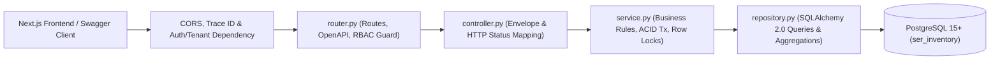
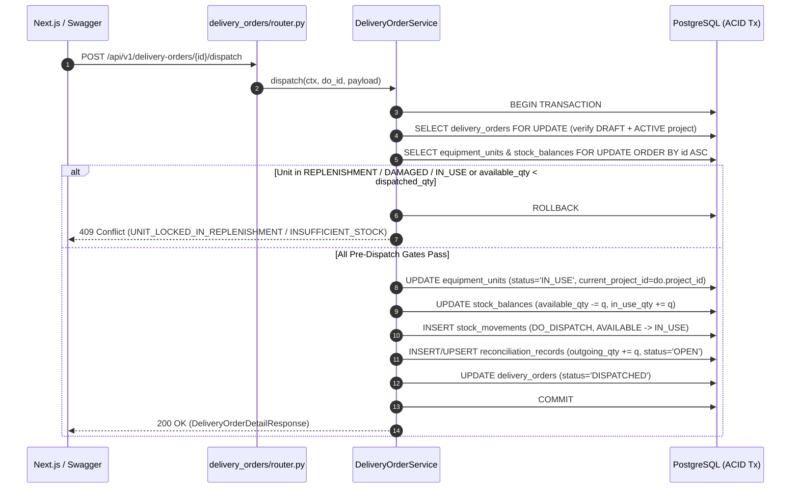

# SDD-2: Backend Architecture & REST API Specification — SER Inventory Management System

> **Single Source of Truth** for the FastAPI backend architecture, RBAC & multi-tenant security model, `/api/v1` REST API contracts, pre-aggregated frontend chart/analytics endpoints, ACID service workflows, and error-handling standards.
> **Upstream Dependency:** Locked [`docs/sdd-1-Database.md`](sdd-1-Database.md) (`SDD-1-DB` v1.0.0, Alembic revision `18f4ee7f7aa7`).
> **Implementation Gate:** **LOCKED** — Approved as the canonical backend architecture & REST API blueprint for Phase A, Phase B, and Phase C implementation.

---

## 1. Document Metadata & Backend Architectural Principles

### 1.1 Metadata

| Attribute | Value |
| --- | --- |
| **Document ID** | `SDD-2-BE` |
| **Version** | `1.0.0` |
| **Status** | `LOCKED` |
| **Database Baseline** | `SDD-1-DB` v1.0.0 (`18f4ee7f7aa7`, 12 PostgreSQL tables + 10 triggers + 16 custom indexes) |
| **Seeded Dev Baseline** | `148` catalog `items` (`14` `ASSET`, `134` `ACCESSORY`), `55` `equipment_units`, `148` `stock_balances`, `55` `OPENING_STOCK` movements |
| **Backend Stack** | FastAPI (Python 3.11+), Pydantic v2, SQLAlchemy 2.0 (sync pooled sessions), Alembic, PostgreSQL 15+ |
| **API Prefix & Docs** | `/api/v1`, OpenAPI JSON at `/api/v1/openapi.json`, Swagger UI at `/docs` |

### 1.2 Modular Monolith Layered Architecture

The backend follows a strict **Modular Monolith** pattern aligned with `backend/app/`. Each domain owns its vertical slice with strict top-down dependency direction — lower layers never import from upper layers:



| Layer File | Responsibility | Prohibited Concerns |
| --- | --- | --- |
| `router.py` | FastAPI `APIRouter` route declarations, query/path parameter parsing, RBAC role dependency guards (`require_roles(...)`), DI wiring. | Direct SQLAlchemy queries, transaction commits, business state checks. |
| `controller.py` | Adapts validated request schemas into service calls; wraps outputs in `APIResponse[T]` / `PaginatedResponse[T]` / `ChartSeriesResponse[T]` and sets HTTP status codes. | Database locks, multi-table orchestration, raw SQL. |
| `service.py` | Owns domain invariants, state machine validation, `with db.begin():` ACID transaction boundaries, deadlock-free `SELECT ... FOR UPDATE` ordering, cross-domain orchestration (`stock_balances` + `equipment_units` + `stock_movements` + `reconciliation_records`). | HTTP status codes, FastAPI `Request`/`Response` objects. |
| `repository.py` | Parameterized SQLAlchemy 2.0 `select()` / `insert()` / `update()` data access, `selectinload`/`joinedload` eager loading, and server-side SQL `GROUP BY` / `CASE WHEN` aggregations. | Committing transactions (`db.commit()` belongs to `service.py`), RBAC logic. |
| `schemas.py` | Strict Pydantic v2 DTOs (`Create`, `Update`, `Filter`, `Response`, `Summary`, `ChartSeries`) with explicit `Decimal` validation and `ConfigDict(from_attributes=True)`. | ORM session logic or DB I/O. |
| `models.py` | SQLAlchemy 2.0 ORM table mappings (already implemented per SDD-1). | Business rules or HTTP serialization. |

### 1.3 Core Backend Engineering Principles

1. **Database-First Integrity + Service-Level Pre-Validation:** Every invariant enforced by PostgreSQL `CHECK` constraints and triggers (non-negative balances, serialization consistency, append-only `stock_movements`, generated `variance_qty`) is also validated proactively in `service.py` to produce clear, actionable domain error codes (`409 Conflict` / `422 Unprocessable Entity`) rather than raw `IntegrityError` stack traces.
2. **Single-Transaction Atomicity & Deadlock Prevention:** Any workflow touching multiple inventory tables (`DO Dispatch`, `CO Receive`, `Replenishment Complete`, `Loss Write-Off`) acquires row locks via `SELECT ... FOR UPDATE` in deterministic primary-key order (`ORDER BY id ASC`) inside one transaction boundary.
3. **Zero N+1 & Aggregation-First Read Paths:** List endpoints use explicit `JOIN`s / `selectinload`, and frontend dashboard/chart endpoints execute single-pass PostgreSQL `GROUP BY` + `SUM(CASE WHEN ...)` queries so the Next.js frontend never downloads raw tables to compute KPIs or charts client-side.
4. **Strict Tenant Isolation:** Every query is scoped by `organization_id` resolved from the authenticated context — never blindly accepted from client request payloads.

---

## 2. Directory & Module Map (Aligned to Current Repo)

The map below aligns directly with the existing `backend/app/` layout and introduces two clean read/workflow domain modules (`analytics` and `workshop`) for SDD-2:

```text
backend/
├── database/
│   ├── base.py                 # DeclarativeBase, UUIDPrimaryKeyMixin, TimestampMixin
│   ├── session.py              # Engine, SessionLocal, get_db(), check_db_connection()
│   ├── models.py               # Central registry of all 12 SDD-1 ORM models
│   ├── migrations/             # Alembic env + 18f4ee7f7aa7_initial_sdd1_schema.py
│   └── seeds/                  # import_material_list.py & dev seeds
└── app/
    ├── main.py                 # FastAPI factory, CORS, trace-id middleware, /health, /api/v1 mount
    ├── api/v1/router.py        # Aggregates all domain routers below
    ├── core/
    │   ├── config.py           # Pydantic Settings v2 (APP_ENV, DATABASE_URL, JWT_*, DEV_AUTH_BYPASS)
    │   ├── security.py         # JWT encode/decode, password hashing (Argon2/bcrypt), token verification
    │   ├── dependencies.py     # DbSession, PaginationDep, CurrentUserDep, require_roles()
    │   ├── exceptions.py       # AppException hierarchy + global JSON error handler with trace_id
    │   └── logging.py          # Structured request & error logging
    ├── shared/
    │   ├── schemas.py          # APIResponse[T], PaginatedResponse[T], PaginationMeta, ChartSeriesResponse[T]
    │   ├── repository.py       # BaseRepository[ModelT] with tenant-scoped helpers
    │   └── enums.py            # Canonical StrEnums mirroring SDD-1 CHECK constraints
    └── modules/
        ├── auth/               # Login, token refresh, /me identity context
        ├── users/              # Organizations & Users management (Organization, User models)
        ├── projects/           # Dewatering & construction project sites (Project model)
        ├── items/              # Master catalog ASSET & ACCESSORY CRUD + search (Item model)
        ├── equipment_units/    # Serialized unit registry, custody & movement timeline (EquipmentUnit model)
        ├── stock_balances/     # Real-time buckets, AED valuation, opening stock & manual adjustments
        ├── delivery_orders/    # Outgoing DO drafts, line edits, atomic dispatch & cancel
        ├── collection_orders/  # Incoming CO drafts, line receipt & post-return bucket routing
        ├── workshop/           # [SDD-2 Addition] REPLENISHMENT queue & workshop completion release
        ├── stock_movements/    # Read-only immutable audit ledger queries & filtering
        ├── reconciliation/     # Equalization views, discrepancy flagging, loss write-off & resolution
        ├── analytics/          # [SDD-2 Addition] Pre-aggregated KPI cards & chart series for Next.js
        └── ai/                 # Isolated future AI boundary (AI_ENABLED=false, read-only ports)
```

---

## 3. Authentication, Multi-Tenancy & RBAC Matrix

### 3.1 Request Identity & Tenant Resolution (`CurrentUserContext`)

Every `/api/v1/*` endpoint (except `/health` and `/api/v1/auth/login`) resolves a verified `CurrentUserContext` via FastAPI dependency injection (`CurrentUserDep`):

```python
class CurrentUserContext(BaseModel):
    user_id: UUID
    organization_id: UUID
    organization_code: str
    email: str
    full_name: str
    role: Literal["ADMIN", "SER_OPERATOR", "WORKSHOP_LEAD", "PROJECT_VIEWER"]
```

- **Production / Staging Auth Flow (JWT):**
  1. `POST /api/v1/auth/login` verifies active user credentials (additive `password_hash` column migration in Phase B auth hardening) and returns `access_token` (30 min TTL) + `refresh_token` (7 days TTL).
  2. JWT claims carry `sub` (`user_id`), `org_id` (`organization_id`), `role`, `type` (`access` / `refresh`), `iat`, `exp`.
  3. `get_current_user` validates JWT signature & expiration, verifies `users.is_active = TRUE` and `organizations.is_active = TRUE`, and constructs `CurrentUserContext`.
- **Local Development / Swagger Bootstrap Mode (`Phase A`):**
  - Enabled **only** when `APP_ENV == "development"` and `DEV_AUTH_BYPASS == True` (strictly forbidden when `APP_ENV != "development"`).
  - If no `Authorization: Bearer` header is supplied in local dev/Swagger, the dependency checks optional header `X-Dev-User-Email` (defaulting to the seeded `system.import@ser.local` `ADMIN` user) and loads the real `User` + `Organization` row from PostgreSQL.
  - Allows immediate Swagger testing against the imported `148` items and `55` units during Phase A while keeping the exact same `CurrentUserDep` interface used in production.
- **Multi-Tenant Isolation Guarantee:**
  - `organization_id` is **never** trusted from request query strings or JSON bodies.
  - All repository queries explicitly filter `.where(Model.organization_id == ctx.organization_id)`.
  - Referenced foreign keys on writes (`project_id`, `item_id`, `equipment_unit_id`, `delivery_order_id`) are verified to belong to `ctx.organization_id`; cross-tenant IDs return `404 Not Found` (preventing tenant resource enumeration).

### 3.2 Role-Based Access Control (RBAC) Permission Matrix

Enforced via FastAPI dependency `Depends(require_roles("ADMIN", "SER_OPERATOR"))` returning `403 Forbidden` (`error_code = "INSUFFICIENT_ROLE"`) on unauthorized access.

| Capability / Endpoint Group | `ADMIN` | `SER_OPERATOR` | `WORKSHOP_LEAD` | `PROJECT_VIEWER` |
| --- | :---: | :---: | :---: | :---: |
| **Read** Catalog (`items`, `equipment_units`), `projects`, `stock_balances`, `delivery_orders`, `collection_orders`, `stock_movements`, `reconciliation`, `analytics` | Allow | Allow | Allow | Allow |
| **Manage Organizations & Users** (`POST`/`PATCH` `/users`, `/organizations`) | Allow | Deny | Deny | Deny |
| **Manage Master Data** (`POST`/`PATCH` `/projects`, `/items`, `/equipment-units`) | Allow | Allow | Deny *(condition notes only)* | Deny |
| **Draft / Edit / Cancel Delivery Orders (`DO`)** | Allow | Allow | Deny | Deny |
| **Issue / Dispatch Delivery Order (`POST /delivery-orders/{id}/dispatch`)** | Allow | Allow | Deny | Deny |
| **Draft / Edit / Cancel Collection Orders (`CO`)** | Allow | Allow | Allow | Deny |
| **Receive / Confirm Collection Order (`POST /collection-orders/{id}/receive`)** | Allow | Allow | Allow | Deny |
| **Complete Workshop Replenishment (`POST /workshop/replenishment/complete`)** | Allow | Deny | Allow | Deny |
| **Record Opening Stock / Manual Stock Adjustment** | Allow | Deny | Deny | Deny |
| **Flag Reconciliation Discrepancy (`POST /reconciliation/{id}/flag-discrepancy`)** | Allow | Allow | Deny | Deny |
| **Loss Write-Off (`POST /reconciliation/{id}/write-off`)** | Allow | Deny | Deny | Deny |
| **Resolve Discrepancy (`POST /reconciliation/{id}/resolve`)** | Allow | Deny | Deny | Deny |

---

## 4. Complete REST API Contract (`/api/v1/...`)

### 4.1 Global Envelope & Pagination Conventions

- **Single Resource Envelope (`APIResponse[T]`):**
  ```json
  { "data": { "...": "..." }, "message": "ok" }
  ```
- **Paginated Collection Envelope (`PaginatedResponse[T]`):**
  ```json
  {
    "items": [ { "...": "..." } ],
    "meta": { "page": 1, "page_size": 25, "total": 148, "total_pages": 6 }
  }
  ```
  - Default `page = 1`, `page_size = 25`; hard maximum `page_size = 100` (returns `422` if exceeded).
- **Chart / Analytics Envelope (`ChartSeriesResponse[T]`):**
  ```json
  {
    "data": { "...": "..." },
    "generated_at": "2026-11-21T08:45:00Z",
    "filters_applied": { "date_from": "2026-10-01", "date_to": "2026-11-21" }
  }
  ```
- **Numeric Serialization:** Quantities (`NUMERIC(14, 3)`) and AED prices (`NUMERIC(12, 2)`) are validated via Pydantic `Decimal` and serialized consistently (numeric JSON values or fixed-precision strings — standardizing on `Decimal` with `float`/fixed-scale formatting documented in OpenAPI).

---

### 4.2 Auth & Identity APIs (`/api/v1/auth`)

| Method | Path | Roles | Request Schema | Response Schema | Status Codes |
| --- | --- | --- | --- | --- | --- |
| `POST` | `/api/v1/auth/login` | Public | `LoginRequest` (`email`, `password`, optional `organization_code`) | `APIResponse[TokenPairResponse]` (`access_token`, `refresh_token`, `token_type`, `expires_in`, `user`) | `200`, `401`, `422` |
| `POST` | `/api/v1/auth/refresh` | Public | `RefreshTokenRequest` (`refresh_token`) | `APIResponse[TokenPairResponse]` | `200`, `401`, `422` |
| `GET` | `/api/v1/auth/me` | Any Authenticated | — | `APIResponse[CurrentUserResponse]` | `200`, `401` |

---

### 4.3 Master & Catalog APIs (`organizations`, `users`, `projects`, `items`, `equipment-units`)

#### Organizations & Users

| Method | Path | Roles | Query / Filters | Request Schema | Response Schema | Status Codes |
| --- | --- | --- | --- | --- | --- | --- |
| `GET` | `/api/v1/organizations/current` | Any Auth | — | — | `APIResponse[OrganizationResponse]` | `200`, `401` |
| `PATCH` | `/api/v1/organizations/current` | `ADMIN` | — | `OrganizationUpdate` (`name`) | `APIResponse[OrganizationResponse]` | `200`, `403`, `422` |
| `GET` | `/api/v1/users` | `ADMIN`, `SER_OPERATOR` | `page`, `page_size`, `role`, `is_active`, `search` | — | `PaginatedResponse[UserResponse]` | `200`, `403` |
| `POST` | `/api/v1/users` | `ADMIN` | — | `UserCreate` (`full_name`, `email`, `role`) | `APIResponse[UserResponse]` | `201`, `403`, `409`, `422` |
| `PATCH` | `/api/v1/users/{id}` | `ADMIN` | — | `UserUpdate` (`full_name?`, `role?`, `is_active?`) | `APIResponse[UserResponse]` | `200`, `403`, `404`, `422` |

#### Projects

| Method | Path | Roles | Query / Filters | Request Schema | Response Schema | Status Codes |
| --- | --- | --- | --- | --- | --- | --- |
| `GET` | `/api/v1/projects` | Any Auth | `page`, `page_size`, `status`, `search` (`code`/`name`/`location`) | — | `PaginatedResponse[ProjectSummaryResponse]` (includes active deployed unit count) | `200` |
| `POST` | `/api/v1/projects` | `ADMIN`, `SER_OPERATOR` | — | `ProjectCreate` (`project_code`, `project_name`, `location?`, `start_date?`, `end_date?`) | `APIResponse[ProjectResponse]` | `201`, `403`, `409`, `422` |
| `GET` | `/api/v1/projects/{id}` | Any Auth | — | — | `APIResponse[ProjectDetailResponse]` (project info + live on-site unit count, active DOs, open variance count) | `200`, `404` |
| `PATCH` | `/api/v1/projects/{id}` | `ADMIN`, `SER_OPERATOR` | — | `ProjectUpdate` (`project_name?`, `location?`, `status?`, `start_date?`, `end_date?`) | `APIResponse[ProjectResponse]` | `200`, `403`, `404`, `409`, `422` |

> **Project Closure Guard:** Transitioning `projects.status` to `'CLOSED'` is blocked (`409 Conflict`, `PROJECT_HAS_ACTIVE_EQUIPMENT`) if any `equipment_units` still reference `current_project_id = project.id` or unresolved `reconciliation_records` have `reconciliation_status IN ('OPEN', 'DISCREPANCY')`.

#### Items Catalog (`items`)

| Method | Path | Roles | Query / Filters | Request Schema | Response Schema | Status Codes |
| --- | --- | --- | --- | --- | --- | --- |
| `GET` | `/api/v1/items` | Any Auth | `page`, `page_size`, `search` (`item_code`/`description`), `product_type` (`ASSET`/`ACCESSORY`), `category`, `sub_category`, `is_active`, `sort_by` (`item_code`/`category`/`unit_price_aed`/`available_qty`) | — | `PaginatedResponse[ItemWithStockResponse]` (catalog fields + aggregated `available_qty`, `in_use_qty`, `replenishment_qty`, `damaged_qty`, `total_qty`, `total_value_aed`) | `200` |
| `GET` | `/api/v1/items/categories` | Any Auth | `product_type?` | — | `APIResponse[list[CategoryFacetResponse]]` (distinct `category` + `sub_categories[]` + item counts for filter dropdowns) | `200` |
| `POST` | `/api/v1/items` | `ADMIN`, `SER_OPERATOR` | — | `ItemCreate` (`item_code`, `description`, `uom`, `product_type`, `category`, `sub_category?`, `unit_price_aed`) — auto-derives `is_serialized` from `product_type` | `APIResponse[ItemResponse]` | `201`, `403`, `409`, `422` |
| `GET` | `/api/v1/items/{id}` | Any Auth | — | — | `APIResponse[ItemDetailResponse]` (catalog fields + per-`ownership_source` balances + serialized unit status counts if `ASSET`) | `200`, `404` |
| `PATCH` | `/api/v1/items/{id}` | `ADMIN`, `SER_OPERATOR` | — | `ItemUpdate` (`description?`, `uom?`, `category?`, `sub_category?`, `unit_price_aed?`, `is_active?`) — `product_type`/`is_serialized` immutable once units or movements exist | `APIResponse[ItemResponse]` | `200`, `403`, `404`, `409`, `422` |

#### Serialized Equipment Units (`equipment-units`)

| Method | Path | Roles | Query / Filters | Request Schema | Response Schema | Status Codes |
| --- | --- | --- | --- | --- | --- | --- |
| `GET` | `/api/v1/equipment-units` | Any Auth | `page`, `page_size`, `search` (`serial_number`/`item_code`/`description`), `item_id`, `status` (`AVAILABLE`/`IN_USE`/`REPLENISHMENT`/`DAMAGED`/`RETIRED`), `condition_status`, `current_project_id`, `category` | — | `PaginatedResponse[EquipmentUnitResponse]` (includes joined `item_code`, `item_description`, `category`, `current_project_code`, `current_project_name`) | `200` |
| `POST` | `/api/v1/equipment-units` | `ADMIN`, `SER_OPERATOR` | — | `EquipmentUnitCreate` (`item_id`, `serial_number`, `ownership_source='SER'`, `condition_status='GOOD'`, `notes?`) — verifies `item.is_serialized = TRUE`, increments `stock_balances.available_qty += 1`, appends `OPENING_STOCK` movement | `APIResponse[EquipmentUnitResponse]` | `201`, `400`, `403`, `404`, `409`, `422` |
| `GET` | `/api/v1/equipment-units/{id}` | Any Auth | — | — | `APIResponse[EquipmentUnitDetailResponse]` | `200`, `404` |
| `PATCH` | `/api/v1/equipment-units/{id}` | `ADMIN`, `SER_OPERATOR`, `WORKSHOP_LEAD` | — | `EquipmentUnitUpdate` (`condition_status?`, `notes?`) — operational `status` & `current_project_id` cannot be bypassed here (must flow via DO/CO/Workshop/Adjustment transactions) | `APIResponse[EquipmentUnitResponse]` | `200`, `403`, `404`, `422` |
| `GET` | `/api/v1/equipment-units/{id}/movements` | Any Auth | `page`, `page_size` | — | `PaginatedResponse[StockMovementResponse]` (chronological lifecycle timeline for this physical unit) | `200`, `404` |

---

### 4.4 Stock Count & Real-Time Bucket APIs (`/api/v1/stock-balances`)

| Method | Path | Roles | Query / Filters | Request Schema | Response Schema | Status Codes |
| --- | --- | --- | --- | --- | --- | --- |
| `GET` | `/api/v1/stock-balances` | Any Auth | `page`, `page_size`, `item_id`, `product_type`, `category`, `ownership_source` (`SER`/`SUPPLIER`/`DWT`), `has_replenishment` (`bool`), `has_damaged` (`bool`), `low_stock_only` (`bool`), `search` | — | `PaginatedResponse[StockBalanceResponse]` (`available_qty`, `in_use_qty`, `replenishment_qty`, `damaged_qty`, computed `total_qty`, `available_value_aed`, `in_use_value_aed`, `total_value_aed`, plus joined item metadata) | `200` |
| `GET` | `/api/v1/stock-balances/summary-by-category` | Any Auth | `product_type?`, `ownership_source?` | — | `APIResponse[list[CategoryStockSummaryResponse]]` (live SQL rollup of all 4 buckets + AED valuation per category) | `200` |
| `POST` | `/api/v1/stock-balances/opening-stock` | `ADMIN` | — | `OpeningStockCreate` (`item_id`, `ownership_source`, `quantity > 0`, `notes?`) — for bulk `ACCESSORY` opening stock; upserts `stock_balances.available_qty` + logs `OPENING_STOCK` | `APIResponse[StockBalanceResponse]` | `201`, `400`, `403`, `404`, `409`, `422` |
| `POST` | `/api/v1/stock-balances/adjustments` | `ADMIN` | — | `StockAdjustmentCreate` (`item_id`, `equipment_unit_id?`, `ownership_source`, `from_bucket`, `to_bucket`, `quantity > 0`, `notes` [min 5 chars]) — atomic bucket transfer (e.g., `DAMAGED -> AVAILABLE` after repair or `DAMAGED -> RETIRED`) + `MANUAL_ADJUSTMENT` ledger row | `APIResponse[StockBalanceResponse]` | `200`, `400`, `403`, `404`, `409`, `422` |

---

### 4.5 Delivery Order (`DO`) APIs (`/api/v1/delivery-orders`)

| Method | Path | Roles | Query / Filters | Request Schema | Response Schema | Status Codes |
| --- | --- | --- | --- | --- | --- | --- |
| `GET` | `/api/v1/delivery-orders` | Any Auth | `page`, `page_size`, `project_id`, `status`, `date_from`, `date_to`, `search` (`do_number`/`project_code`) | — | `PaginatedResponse[DeliveryOrderSummaryResponse]` (header + line count + total dispatched/returned/outstanding qty) | `200` |
| `POST` | `/api/v1/delivery-orders` | `ADMIN`, `SER_OPERATOR` | — | `DeliveryOrderCreate` (`do_number`, `project_id`, `dispatch_date`, `remarks?`, `lines: list[DeliveryOrderLineCreate]`) — creates `DRAFT` DO without deducting stock | `APIResponse[DeliveryOrderDetailResponse]` | `201`, `400`, `403`, `404`, `409`, `422` |
| `GET` | `/api/v1/delivery-orders/{id}` | Any Auth | — | — | `APIResponse[DeliveryOrderDetailResponse]` (header + eager-loaded lines with item codes, serial numbers, dispatched/returned/lost/remaining qty) | `200`, `404` |
| `PATCH` | `/api/v1/delivery-orders/{id}` | `ADMIN`, `SER_OPERATOR` | — | `DeliveryOrderUpdate` (`dispatch_date?`, `remarks?`, `lines?`) — allowed **only** while `status == 'DRAFT'` | `APIResponse[DeliveryOrderDetailResponse]` | `200`, `403`, `404`, `409`, `422` |
| `POST` | `/api/v1/delivery-orders/{id}/dispatch` | `ADMIN`, `SER_OPERATOR` | — | `DeliveryOrderDispatchRequest` (optional `dispatch_date`, `remarks`) | `APIResponse[DeliveryOrderDetailResponse]` — executes atomic `AVAILABLE -> IN_USE` dispatch (Section 5.1) | `200`, `403`, `404`, `409`, `422` |
| `POST` | `/api/v1/delivery-orders/{id}/cancel` | `ADMIN`, `SER_OPERATOR` | — | `CancelOrderRequest` (`reason`) — allowed **only** while `status == 'DRAFT'` | `APIResponse[DeliveryOrderResponse]` | `200`, `403`, `404`, `409` |

---

### 4.6 Collection Order (`CO`) APIs (`/api/v1/collection-orders`)

| Method | Path | Roles | Query / Filters | Request Schema | Response Schema | Status Codes |
| --- | --- | --- | --- | --- | --- | --- |
| `GET` | `/api/v1/collection-orders` | Any Auth | `page`, `page_size`, `project_id`, `delivery_order_id`, `status`, `date_from`, `date_to`, `search` (`co_number`) | — | `PaginatedResponse[CollectionOrderSummaryResponse]` | `200` |
| `POST` | `/api/v1/collection-orders` | `ADMIN`, `SER_OPERATOR`, `WORKSHOP_LEAD` | — | `CollectionOrderCreate` (`co_number`, `project_id`, `delivery_order_id?`, `collection_date`, `remarks?`, `lines: list[CollectionOrderLineCreate]` with `delivery_order_line_id?`, `item_id`, `equipment_unit_id?`, `ownership_source`, `returned_qty`, `post_return_bucket`, `condition_notes?`) — creates `DRAFT` CO | `APIResponse[CollectionOrderDetailResponse]` | `201`, `400`, `403`, `404`, `409`, `422` |
| `GET` | `/api/v1/collection-orders/{id}` | Any Auth | — | — | `APIResponse[CollectionOrderDetailResponse]` | `200`, `404` |
| `PATCH` | `/api/v1/collection-orders/{id}` | `ADMIN`, `SER_OPERATOR`, `WORKSHOP_LEAD` | — | `CollectionOrderUpdate` (`collection_date?`, `remarks?`, `lines?`) — allowed **only** while `status == 'DRAFT'` | `APIResponse[CollectionOrderDetailResponse]` | `200`, `403`, `404`, `409`, `422` |
| `POST` | `/api/v1/collection-orders/{id}/receive` | `ADMIN`, `SER_OPERATOR`, `WORKSHOP_LEAD` | — | `CollectionOrderReceiveRequest` (optional `collection_date`, `remarks`) | `APIResponse[CollectionOrderDetailResponse]` — executes atomic `IN_USE -> AVAILABLE | REPLENISHMENT | DAMAGED` return + reconciliation update (Section 5.2) | `200`, `403`, `404`, `409`, `422` |
| `POST` | `/api/v1/collection-orders/{id}/cancel` | `ADMIN`, `SER_OPERATOR`, `WORKSHOP_LEAD` | — | `CancelOrderRequest` (`reason`) — allowed **only** while `status == 'DRAFT'` | `APIResponse[CollectionOrderResponse]` | `200`, `403`, `404`, `409` |

---

### 4.7 Workshop Replenishment APIs (`/api/v1/workshop`)

| Method | Path | Roles | Query / Filters | Request Schema | Response Schema | Status Codes |
| --- | --- | --- | --- | --- | --- | --- |
| `GET` | `/api/v1/workshop/replenishment/units` | Any Auth | `page`, `page_size`, `item_id`, `category`, `search` (`serial_number`) | — | `PaginatedResponse[EquipmentUnitResponse]` (locked serialized units with `status == 'REPLENISHMENT'`) | `200` |
| `GET` | `/api/v1/workshop/replenishment/balances` | Any Auth | `page`, `page_size`, `category`, `ownership_source` | — | `PaginatedResponse[StockBalanceResponse]` (items with `replenishment_qty > 0`) | `200` |
| `POST` | `/api/v1/workshop/replenishment/complete` | `WORKSHOP_LEAD`, `ADMIN` | — | `ReplenishmentCompleteRequest` (`item_id`, `equipment_unit_id?`, `ownership_source='SER'`, `quantity` [`1` for serialized], `workshop_ticket_ref?`, `notes?`) | `APIResponse[ReplenishmentCompleteResponse]` — atomically releases `REPLENISHMENT -> AVAILABLE` (Section 5.3) | `200`, `400`, `403`, `404`, `409`, `422` |

---

### 4.8 Audit Ledger & Reconciliation APIs (`/api/v1/stock-movements`, `/api/v1/reconciliation`)

| Method | Path | Roles | Query / Filters | Request Schema | Response Schema | Status Codes |
| --- | --- | --- | --- | --- | --- | --- |
| `GET` | `/api/v1/stock-movements` | Any Auth | `page`, `page_size`, `item_id`, `equipment_unit_id`, `project_id`, `ownership_source`, `movement_type`, `reference_number`, `date_from`, `date_to` | — | `PaginatedResponse[StockMovementResponse]` (newest first `created_at DESC`, joined with `item_code`, `serial_number`, `project_code`, `created_by_name`) | `200` |
| `GET` | `/api/v1/reconciliation` | Any Auth | `page`, `page_size`, `project_id`, `delivery_order_id`, `item_id`, `reconciliation_status` (`OPEN`/`EQUALIZED`/`DISCREPANCY`/`RESOLVED`), `only_with_variance` (`bool`) | — | `PaginatedResponse[ReconciliationRecordResponse]` (includes DB-computed `variance_qty` and `variance_value_aed = variance_qty * unit_price_aed`) | `200` |
| `GET` | `/api/v1/reconciliation/{id}` | Any Auth | — | — | `APIResponse[ReconciliationDetailResponse]` (record + linked DO/CO movement audit history) | `200`, `404` |
| `POST` | `/api/v1/reconciliation/{id}/flag-discrepancy` | `ADMIN`, `SER_OPERATOR` | — | `FlagDiscrepancyRequest` (`notes`) — transitions `OPEN` -> `DISCREPANCY` when `variance_qty > 0` | `APIResponse[ReconciliationRecordResponse]` | `200`, `403`, `404`, `409`, `422` |
| `POST` | `/api/v1/reconciliation/{id}/write-off` | `ADMIN` | — | `LossWriteOffRequest` (`write_off_qty > 0`, `ownership_source='SER'`, `notes` [mandatory], `resolve_if_zero=True`) — executes `LOSS_WRITE_OFF` transaction (Section 5.5) | `APIResponse[ReconciliationRecordResponse]` | `200`, `400`, `403`, `404`, `409`, `422` |
| `POST` | `/api/v1/reconciliation/{id}/resolve` | `ADMIN` | — | `ResolveDiscrepancyRequest` (`resolution_notes` [mandatory]) — stamps `reconciliation_status = 'RESOLVED'`, `resolved_by`, `resolved_at` | `APIResponse[ReconciliationRecordResponse]` | `200`, `403`, `404`, `409`, `422` |

---

### 4.9 Frontend Chart & Dashboard Analytics APIs (`/api/v1/analytics`)

All analytics endpoints are **read-only**, authenticated (`Any Auth`), tenant-scoped by `organization_id`, and powered by server-side PostgreSQL aggregations so the Next.js frontend renders charts directly with zero N+1 queries.

| # | Method & Path | Chart / UI Component | Query Parameters | Key Returned Metrics |
| --- | --- | --- | --- | --- |
| 1 | `GET /api/v1/analytics/kpi-summary` | Top KPI Cards Grid | `ownership_source?` | `total_asset_units`, `total_accessory_skus`, `total_catalog_items`, bucket counts & AED values (`available`, `in_use`, `replenishment`, `damaged`), `utilization_rate_pct`, `active_projects_count`, `open_discrepancies_count`, `total_variance_value_aed`. |
| 2 | `GET /api/v1/analytics/stock-distribution` | Stacked Bar / Donut Chart | `group_by` (`category` \| `product_type` \| `ownership_source`), `product_type?`, `ownership_source?` | Array of series rows `{ label, available_qty, in_use_qty, replenishment_qty, damaged_qty, total_qty, total_value_aed }`. |
| 3 | `GET /api/v1/analytics/project-utilization` | Horizontal Bar / Exposure Table | `status='ACTIVE'`, `limit=10` (max `50`), `sort_by` (`deployed_value_aed` \| `deployed_units` \| `outstanding_qty`) | Ranked projects `{ project_id, project_code, project_name, deployed_units_count, bulk_in_use_qty, open_dos_count, outstanding_variance_qty, deployed_value_aed }`. |
| 4 | `GET /api/v1/analytics/movement-trends` | Line / Area Time-Series Chart | `granularity` (`day` \| `week`), `date_from` (default `-30d`), `date_to` (default `today`), `product_type?`, `project_id?` | Zero-filled PostgreSQL `generate_series` buckets: `{ period_start, dispatched_qty, returned_available_qty, returned_replenishment_qty, returned_damaged_qty, replenishment_completed_qty, loss_write_off_qty }`. |
| 5 | `GET /api/v1/analytics/reconciliation-health` | Reconciliation Donut & Variance Bar | `project_id?`, `date_from?`, `date_to?` | Status breakdown `{ status, record_count, total_outgoing_qty, total_incoming_qty, total_lost_qty, total_variance_qty, total_variance_value_aed }` + `equalization_rate_pct`. |

#### Example Response Payload — `GET /api/v1/analytics/kpi-summary`
```json
{
  "data": {
    "catalog": {
      "total_items": 148,
      "asset_skus": 14,
      "accessory_skus": 134,
      "total_serialized_units": 55
    },
    "buckets": {
      "available": { "qty": "55.000", "units": 55, "value_aed": "0.00" },
      "in_use": { "qty": "0.000", "units": 0, "value_aed": "0.00" },
      "replenishment": { "qty": "0.000", "units": 0, "value_aed": "0.00" },
      "damaged": { "qty": "0.000", "units": 0, "value_aed": "0.00" }
    },
    "utilization_rate_pct": 0.0,
    "active_projects_count": 0,
    "open_discrepancies_count": 0,
    "total_variance_value_aed": "0.00"
  },
  "generated_at": "2026-11-21T08:45:00Z",
  "filters_applied": { "ownership_source": null }
}
```

#### Example Response Payload — `GET /api/v1/analytics/stock-distribution?group_by=category`
```json
{
  "data": {
    "group_by": "category",
    "series": [
      {
        "label": "Equipment",
        "available_qty": "42.000",
        "in_use_qty": "0.000",
        "replenishment_qty": "0.000",
        "damaged_qty": "0.000",
        "total_qty": "42.000",
        "total_value_aed": "0.00"
      }
    ]
  },
  "generated_at": "2026-11-21T08:45:00Z",
  "filters_applied": { "group_by": "category" }
}
```

---

### 4.10 Isolated AI Module Boundary (`/api/v1/ai`)

- Remains disabled by default (`AI_ENABLED=false` in `app.core.config.settings`).
- `GET /api/v1/ai/status` returns module availability without touching transactional tables.
- Future AI endpoints (forecasting, anomaly detection, natural-language inventory Q&A) will consume **read-only** repository queries from `analytics` and `stock_movements` via `app/modules/ai/interfaces.py` (`AIProviderPort`) with zero write permissions on inventory tables.

---

## 5. Transactional Service Workflows, Locking & Error Handling

### 5.1 Dispatch Delivery Order (`dispatch_delivery_order`)



**Exact Execution Steps (Single Transaction):**
1. Lock `delivery_orders` row by `(id, ctx.organization_id)` via `SELECT ... FOR UPDATE`; reject if `status != 'DRAFT'` (`INVALID_STATE_TRANSITION`) or `lines` is empty (`EMPTY_ORDER_LINES`).
2. Verify target `projects` row belongs to `ctx.organization_id` and has `status == 'ACTIVE'` (`PROJECT_NOT_ACTIVE`).
3. Collect distinct `equipment_unit_id`s and `(item_id, ownership_source)` pairs across all `delivery_order_lines`, sort deterministically (`ORDER BY id ASC`), and lock rows via `SELECT ... FOR UPDATE`.
4. **Pre-Dispatch Replenishment Lock (Hard Gate):**
   - For serialized lines (`item.is_serialized == True`): require `equipment_unit_id IS NOT NULL`, `dispatched_qty == 1`, `unit.item_id == line.item_id`, `unit.status == 'AVAILABLE'`, `unit.current_project_id IS NULL`. Raise `UnitLockedInReplenishmentError` specifically when `unit.status == 'REPLENISHMENT'`, or `UnitNotAvailableError` for `IN_USE`/`DAMAGED`/`RETIRED`.
   - For every `(item_id, ownership_source)`: aggregate total requested `dispatched_qty` across lines and verify `balance.available_qty >= total_requested_qty`; otherwise raise `InsufficientStockError`.
5. Mutate state atomically:
   - Serialized units: `status = 'IN_USE'`, `current_project_id = do.project_id`.
   - `stock_balances`: `available_qty -= line.dispatched_qty`, `in_use_qty += line.dispatched_qty`.
   - `stock_movements`: insert `movement_type = 'DO_DISPATCH'`, `from_bucket = 'AVAILABLE'`, `to_bucket = 'IN_USE'`, `reference_type = 'DELIVERY_ORDER'`, `reference_number = do.do_number`, `created_by = ctx.user_id`.
   - `reconciliation_records`: insert or increment `outgoing_qty += line.dispatched_qty`, `reconciliation_status = 'OPEN'`.
   - `delivery_orders`: `status = 'DISPATCHED'`.

### 5.2 Receive Collection Order (`receive_collection_order`)
1. Lock `collection_orders` row via `SELECT ... FOR UPDATE`; verify `status == 'DRAFT'` and non-empty `lines`.
2. Lock referenced `equipment_units`, `stock_balances`, `delivery_order_lines`, `delivery_orders`, and `reconciliation_records` rows in deterministic `ORDER BY id ASC` order.
3. Validate bounds per line:
   - Serialized unit: `unit.status == 'IN_USE'` and `unit.current_project_id == co.project_id` (`UNIT_NOT_AT_PROJECT`).
   - Balance: `balance.in_use_qty >= line.returned_qty` (`INSUFFICIENT_IN_USE_STOCK`).
   - DO line (if linked): `do_line.returned_qty + do_line.lost_qty + line.returned_qty <= do_line.dispatched_qty` (`RETURN_EXCEEDS_DISPATCHED`).
4. Route each line by `post_return_bucket` (`AVAILABLE` | `REPLENISHMENT` | `DAMAGED`):
   - Serialized unit: `current_project_id = NULL`, `status = post_return_bucket`, `condition_status = {'AVAILABLE': 'GOOD', 'REPLENISHMENT': 'NEEDS_SERVICE', 'DAMAGED': 'DAMAGED'}[post_return_bucket]`.
   - `stock_balances`: `in_use_qty -= returned_qty` and increment target column (`available_qty` / `replenishment_qty` / `damaged_qty`).
   - `stock_movements`: append `CO_RETURN_<POST_RETURN_BUCKET>`, `from_bucket = 'IN_USE'`, `to_bucket = post_return_bucket`, `reference_type = 'COLLECTION_ORDER'`, `reference_number = co.co_number`.
   - `delivery_order_lines`: `returned_qty += line.returned_qty`.
   - `reconciliation_records`: `incoming_qty += line.returned_qty`; flush so PostgreSQL recomputes stored generated `variance_qty`; if `variance_qty == 0` and `reconciliation_status != 'RESOLVED'`, set `reconciliation_status = 'EQUALIZED'`.
5. Update parent `delivery_orders.status`: `'CLOSED'` if all lines satisfy `returned_qty + lost_qty == dispatched_qty`, else `'PARTIALLY_RETURNED'`.
6. Update `collection_orders.status = 'RECEIVED'`.

### 5.3 Complete Workshop Replenishment (`complete_replenishment`)
*(Restricted to `WORKSHOP_LEAD` and `ADMIN`)*
1. Lock target `equipment_units` (if serialized) and `stock_balances` (`ORDER BY id ASC`).
2. Verify `unit.status == 'REPLENISHMENT'` (if serialized) and `balance.replenishment_qty >= quantity`.
3. Update `unit.status = 'AVAILABLE'`, `unit.condition_status = 'GOOD'` (if serialized).
4. Update `balance.replenishment_qty -= quantity`, `balance.available_qty += quantity`.
5. Append `stock_movements`: `movement_type = 'REPLENISHMENT_COMPLETE'`, `from_bucket = 'REPLENISHMENT'`, `to_bucket = 'AVAILABLE'`, `project_id = NULL`, `reference_type = 'WORKSHOP_TICKET'`, `reference_number = workshop_ticket_ref`.

### 5.4 Opening Stock & Manual Adjustments (`record_opening_or_adjustment`)
*(Restricted to `ADMIN`)*
1. **Opening Stock (`ACCESSORY`):** Lock/upsert `stock_balances(org, item, ownership_source)`; increment `available_qty += quantity`; append `OPENING_STOCK` (`EXTERNAL -> AVAILABLE`, `reference_type = 'OPENING_BALANCE'`).
2. **Manual Adjustment:** Lock `equipment_units` (if serialized) and `stock_balances`; validate `from_bucket != to_bucket`, source bucket has `>= quantity`, and disallow direct `IN_USE` bypasses (site custody must go through DO/CO or `LOSS_WRITE_OFF`); transfer quantities, update unit status if serialized (e.g., `DAMAGED -> AVAILABLE` or `DAMAGED -> RETIRED`), and append `MANUAL_ADJUSTMENT` with mandatory `notes`.

### 5.5 Loss Write-Off & Discrepancy Resolution (`write_off_loss`, `resolve_discrepancy`)
*(Restricted to `ADMIN`)*
1. Lock `reconciliation_records`, matching `delivery_order_lines`, `stock_balances`, and `equipment_units` (if serialized) (`ORDER BY id ASC`).
2. Validate `0 < write_off_qty <= recon.variance_qty` and `balance.in_use_qty >= write_off_qty`.
3. Update `balance.in_use_qty -= write_off_qty`; if serialized, set `unit.status = 'RETIRED'`, `unit.current_project_id = NULL`, append loss reference to `unit.notes`.
4. Increment `do_line.lost_qty += write_off_qty` and `recon.lost_qty += write_off_qty`.
5. Append `stock_movements`: `movement_type = 'LOSS_WRITE_OFF'`, `from_bucket = 'IN_USE'`, `to_bucket = 'LOST'`, `reference_type = 'RECONCILIATION'`, mandatory `notes`.
6. Flush so PostgreSQL recomputes `variance_qty`; update `reconciliation_status` (`'RESOLVED'` with `resolved_by = ctx.user_id, resolved_at = now()` if closing a discrepancy or `resolve_if_zero=True`, else `'EQUALIZED'` when `variance_qty == 0`), and re-evaluate parent `delivery_orders.status` (`'CLOSED'` if all lines equalized).

### 5.6 Standardized Error Envelope & Domain Exception Mapping

Every non-2xx response returns a uniform JSON structure (evolving `backend/app/core/exceptions.py` with a request-scoped `trace_id` attached by middleware):

```json
{
  "error": {
    "error_code": "UNIT_LOCKED_IN_REPLENISHMENT",
    "message": "Equipment unit 'GEN-250KVA-004' is locked in workshop REPLENISHMENT and cannot be dispatched.",
    "details": {
      "equipment_unit_id": "a1b2c3d4-...",
      "serial_number": "GEN-250KVA-004",
      "current_status": "REPLENISHMENT"
    },
    "trace_id": "req_9f3c2a1b8e7d"
  }
}
```

| Domain Exception Class | `error_code` | HTTP Status | Trigger Condition |
| --- | --- | :---: | --- |
| `UnauthorizedError` | `UNAUTHORIZED` | `401` | Missing, expired, or invalid JWT / inactive user. |
| `InsufficientRoleError` | `INSUFFICIENT_ROLE` | `403` | Authenticated role not permitted by RBAC matrix. |
| `NotFoundError` | `RESOURCE_NOT_FOUND` | `404` | Entity ID missing or belongs to another organization. |
| `DuplicateBusinessKeyError` | `DUPLICATE_BUSINESS_KEY` | `409` | Duplicate `item_code`, `serial_number`, `project_code`, `do_number`, `co_number`, or `email` within org. |
| `UnitLockedInReplenishmentError` | `UNIT_LOCKED_IN_REPLENISHMENT` | `409` | Attempt to dispatch a serialized unit currently in `REPLENISHMENT`. |
| `UnitNotAvailableError` | `UNIT_NOT_AVAILABLE` | `409` | Attempt to dispatch a unit in `IN_USE`, `DAMAGED`, or `RETIRED`. |
| `InsufficientStockError` | `INSUFFICIENT_STOCK` | `409` | `available_qty < requested_qty` (or `replenishment_qty` / `in_use_qty` shortfall). |
| `InvalidStateTransitionError` | `INVALID_STATE_TRANSITION` | `409` | Editing/cancelling non-`DRAFT` DO/CO, double-dispatching, or closing project with active equipment. |
| `ReconciliationBoundsError` | `RECONCILIATION_BOUNDS_EXCEEDED` | `409` | `returned_qty + lost_qty` would exceed `dispatched_qty` / `outgoing_qty`. |
| `ProjectNotActiveError` | `PROJECT_NOT_ACTIVE` | `409` | Attempting to dispatch a DO to a `COMPLETED` or `CLOSED` project. |
| `ValidationDomainError` | `DOMAIN_VALIDATION_ERROR` | `422` | Serialized item without `equipment_unit_id`, `dispatched_qty != 1` for serialized unit, or missing mandatory adjustment notes. |
| `LedgerImmutabilityError` | `LEDGER_IMMUTABLE` | `405` / `409` | Defensive catch if any code path triggers `trg_stock_movements_immutable`. |

---

## 6. Performance, Scalability & Phased Implementation Roadmap

### 6.1 SQLAlchemy 2.0 Query Optimization & Index Alignment

| Read / Write Workload | Primary SDD-1 Index Used | Query Optimization Pattern |
| --- | --- | --- |
| Catalog search & SKU lookup | `idx_items_org_code` | Prefix/ILIKE filter with `LEFT JOIN` aggregated `stock_balances` subquery (single query, 0 N+1). |
| Yard available units & workshop queue | `idx_equip_units_org_status` | Composite filter `(organization_id, status, item_id)` with `joinedload` to `items` & `projects`. |
| Active units on a project site | `idx_equip_units_current_project` *(partial)* | Index-only scan over active deployed units (`WHERE current_project_id IS NOT NULL`). |
| Live stock counts & category rollup | `idx_stock_balances_org_item` | Server-side `GROUP BY items.category` with `SUM(available_qty * unit_price_aed)` in SQL. |
| Project DO & CO histories | `idx_do_org_project`, `idx_co_org_project` | Index-ordered `dispatch_date DESC` / `collection_date DESC` + `selectinload(lines)` on detail endpoints. |
| Item & unit audit timelines | `idx_movements_org_item_time`, `idx_movements_org_unit_time` | Reverse-chronological range scan; supports cursor pagination (`before_created_at`, `before_id`) as ledger scales into millions of rows. |
| Discrepancy dashboard & filters | `idx_recon_org_status` | Direct index lookup on `(organization_id, reconciliation_status, project_id)` using stored `variance_qty`. |
| Time-series movement charts | `idx_movements_org_item_time` | PostgreSQL `generate_series(...) LEFT JOIN (GROUP BY date_trunc(...))` returns dense chart buckets in 1 SQL round-trip. |

- **Connection Pooling (`backend/database/session.py`):** Configure SQLAlchemy queue pool (`pool_size=10`, `max_overflow=20`, `pool_pre_ping=True`, `pool_recycle=1800`) to handle concurrent Next.js dashboard refreshes cleanly.
- **No Unbounded Queries:** All list endpoints enforce `1 <= page_size <= 100`; analytics endpoints enforce a maximum date window of `366` days per request.

### 6.2 Phased Implementation Roadmap (Step 3 & Step 4 Coding)

#### Phase A — Core Infrastructure, Read/Count APIs & Analytics (Immediate Swagger Verification)
1. **Core Upgrades (`backend/app/core/` & `shared/`):**
   - Enhance `exceptions.py` with the Section 5.6 error envelope (`error_code`, `message`, `details`, `trace_id`) + trace-ID HTTP middleware.
   - Implement `CurrentUserContext`, `DEV_AUTH_BYPASS` (local dev only), `require_roles(...)` RBAC dependency, and `shared/enums.py` mirroring SDD-1 constraints.
   - Update `PaginationMeta` with `total_pages` and add `ChartSeriesResponse[T]`.
2. **Master & Live Read APIs:**
   - Implement `organizations`, `users`, `projects`, `items` (CRUD + `/categories` facets + stock-joined list), `equipment_units` (CRUD + filters + `/movements`), and `stock_balances` (read + `/summary-by-category`).
3. **Analytics Module (`backend/app/modules/analytics/`):**
   - Implement `kpi-summary`, `stock-distribution`, `project-utilization`, `movement-trends`, and `reconciliation-health` endpoints.
4. **Milestone Verification:** Verify all endpoints in Swagger UI (`/docs`) directly against the already-imported `148` items, `55` serialized `equipment_units`, `148` `stock_balances`, and `55` `OPENING_STOCK` rows in PostgreSQL.

#### Phase B — Transactional Order, Workshop, Reconciliation & Production JWT Auth
1. **Delivery & Collection Orders (`delivery_orders`, `collection_orders`):**
   - Full `DRAFT` lifecycle + atomic `POST /dispatch` (with Pre-Dispatch Replenishment Lock) and `POST /receive` (routing to `AVAILABLE` / `REPLENISHMENT` / `DAMAGED`).
2. **Workshop Module (`backend/app/modules/workshop/`):**
   - Replenishment queues + `POST /workshop/replenishment/complete` (`WORKSHOP_LEAD` / `ADMIN`).
3. **Ledger, Adjustments & Reconciliation (`stock_movements`, `stock_balances`, `reconciliation`):**
   - Opening stock & manual adjustments, movement audit filters, discrepancy flagging, `LOSS_WRITE_OFF`, and discrepancy resolution.
4. **Production JWT Auth Hardening (`auth`):**
   - Additive Alembic migration adding `password_hash` to `users` (or `user_credentials`), Argon2/bcrypt password hashing, and `/api/v1/auth/login` + `/refresh`.

#### Phase C — Automated `pytest` Integration & Concurrency Test Suite
- Transactional test database fixtures (`backend/tests/conftest.py`) with isolated rollbacks.
- Automated integration tests verifying:
  - Pre-Dispatch Replenishment Lock (`409 UNIT_LOCKED_IN_REPLENISHMENT`).
  - Concurrent DO dispatch race-condition safety (`SELECT ... FOR UPDATE` preventing negative stock or double-dispatching a serial unit).
  - Multi-CO partial returns (`DISPATCHED -> PARTIALLY_RETURNED -> CLOSED`) and automatic `reconciliation_records.variance_qty == 0 -> EQUALIZED`.
  - Workshop replenishment sign-off (`REPLENISHMENT -> AVAILABLE`) + RBAC `403` enforcement for `SER_OPERATOR` / `PROJECT_VIEWER`.
  - Loss write-off (`LOSS_WRITE_OFF`) + `trg_stock_movements_immutable` protection against `UPDATE`/`DELETE`.
  - Analytics endpoint accuracy against known seeded transactions.
